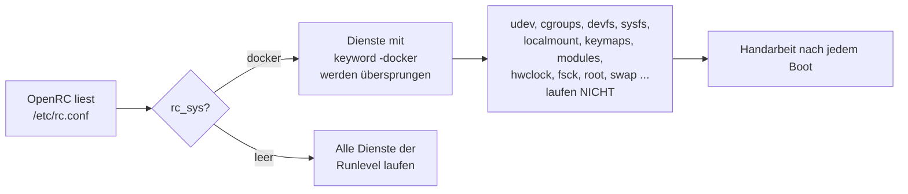
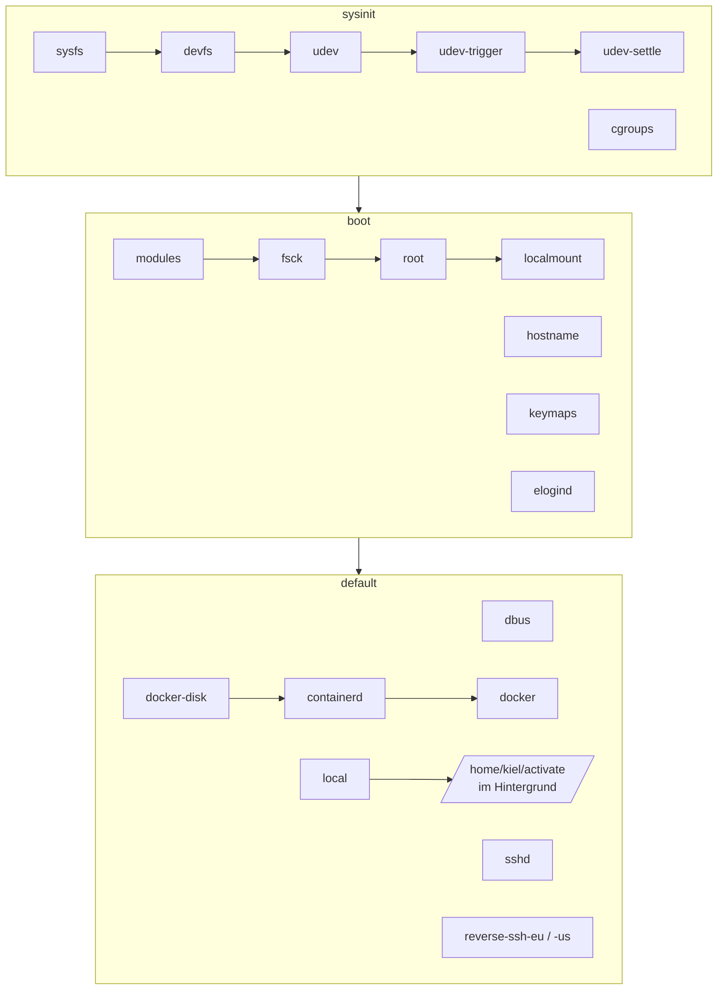
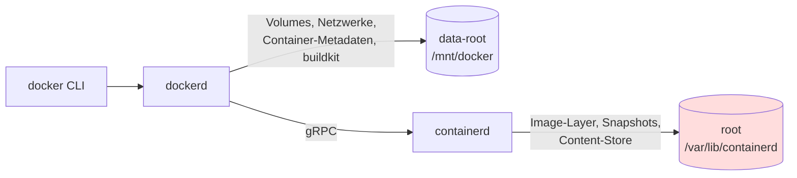
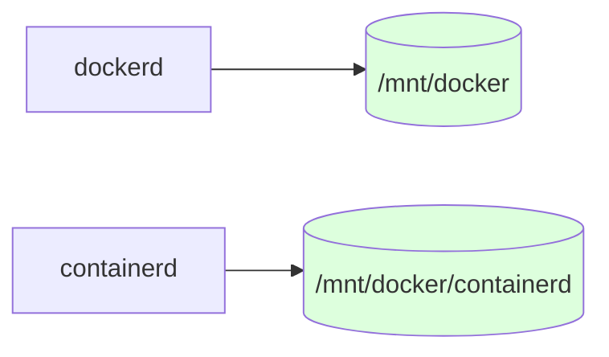
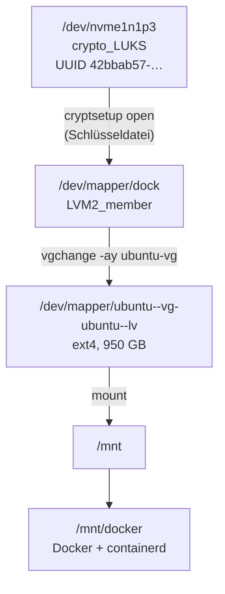
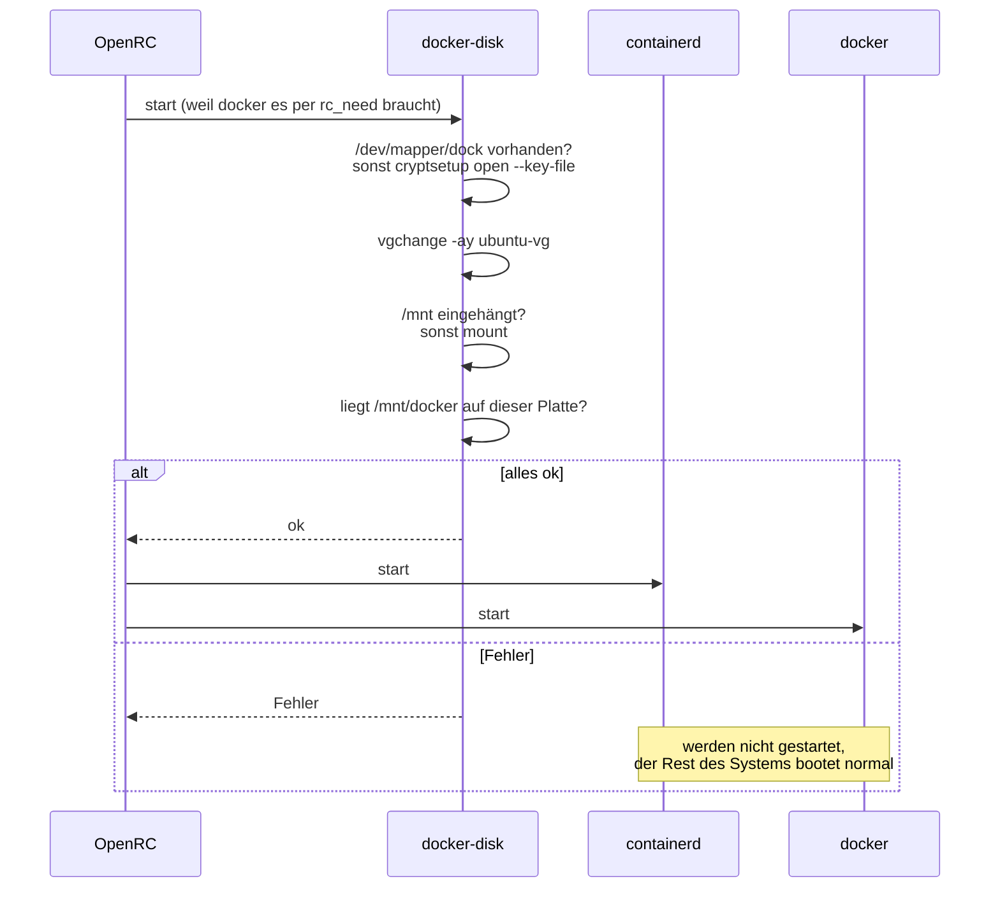
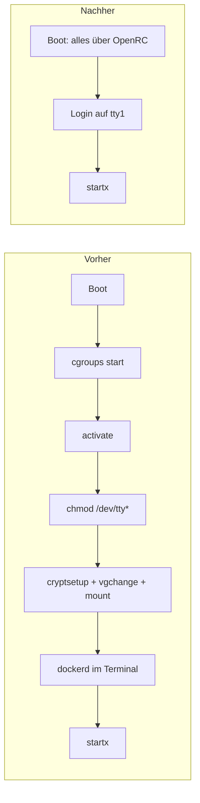

# Docker auf der Datenplatte und ein Systemstart ohne Handarbeit

Dieses Dokument beschreibt die Änderungen vom 2026-10-30 auf dem HP Z6
(installiert nach [install_on_hpz6.md](install_on_hpz6.md)). Es erklärt
das Ziel, die Ursache und die Funktionsweise jeder Änderung. Wer
den Text einmal durchgelesen hat, sollte das System auch ohne dieses
Dokument wieder reparieren können.

## 1. Ausgangslage

Nach jedem Einschalten waren mehrere Handgriffe nötig, bevor man arbeiten
konnte:

```sh
sudo /etc/init.d/cgroups start
sudo /home/kiel/activate
sudo chmod a+rwx /dev/tty*
startx
```

Für Docker kamen noch diese Schritte dazu:

```sh
sudo cryptsetup luksOpen /dev/nvme1n1p3 dock
sudo vgchange -ay
sudo mount /dev/mapper/ubuntu--vg-ubuntu--lv /mnt
sudo /usr/bin/dockerd          # im Vordergrund, in einem eigenen Terminal
```

Die Ziele:

1. Docker legt seine Daten auf der 1-TB-Platte (`/mnt/docker`) ab und
   nicht auf dem Root-Dateisystem.
2. Docker startet beim Booten von selbst.
3. Die übrigen Handgriffe entfallen, soweit es geht.

## 2. Die eigentliche Ursache: `rc_sys="docker"`

Das System wird **in einem Docker-Container gebaut** (siehe `Dockerfile`)
und danach als squashfs gebootet. Das Basis-Image `gentoo/stage3` ist für
Container gedacht und schreibt deshalb in `/etc/rc.conf`:

```sh
rc_sys="docker"
```

OpenRC erfährt damit, dass es in einem Container läuft. Viele
Init-Skripte schließen sich für diesen Fall selbst aus, zum Beispiel
`/etc/init.d/localmount`:

```sh
depend() {
	...
	keyword -docker -podman -jail -lxc -prefix -systemd-nspawn -vserver -wsl
}
```

`keyword -docker` heißt: „Wenn `rc_sys` den Wert `docker` hat, überspringe
mich.“ In einem Container ist das sinnvoll, denn dort kümmert sich der Host
um Geräte, cgroups und Dateisysteme. Auf echter Hardware gibt es aber
keinen Host, der das übernimmt.



Die Symptome lassen sich damit alle erklären:

| Symptom | Fehlender Dienst | Erklärung |
| :--- | :--- | :--- |
| `cgroups start` nötig | `cgroups` | Docker braucht die cgroup-Hierarchie. |
| `chmod a+rwx /dev/tty*` nötig | `udev` (`keyword -containers`) | Ohne udev bekommen Geräte keine Seat-Tags. elogind kann dann kein `seat0` bilden, und das nicht-suid Xorg darf weder TTY noch Eingabegeräte öffnen. |
| Tastaturlayout von Hand | `keymaps` | wurde nie ausgeführt |
| Module von Hand | `modules` | wurde nie ausgeführt |

Das zeigt sich auch in `loginctl`: Die Sessions hatten weder Seat noch TTY.

```text
SESSION  UID USER SEAT TTY   STATE
     c5 1000 kiel -    -     active
```

### Die Korrektur

```sh
# /etc/rc.conf
rc_sys=""
```

Ein leerer Wert bedeutet „echte Maschine“. Danach listet `rc-status` die
vorher unsichtbaren Dienste wieder auf. Ich habe sie im laufenden Betrieb
einzeln gestartet, und alle meldeten `[ ok ]`. Die alte Datei liegt unter
`/etc/rc.conf.bak-20261030`.

In diesem Zusammenhang ist ein zweiter Fehler aufgefallen. In
`/etc/conf.d/keymaps` stand bisher `keymap="colemak"`, und eine Belegung
mit diesem Namen gibt es nicht:

```sh
$ loadkeys -p colemak            # schlägt fehl
$ loadkeys -p colemak/en-latin9  # ok
```

Der Wert lautet jetzt `keymap="colemak/en-latin9"`.

## 3. Wie OpenRC bootet und wo jetzt was läuft

OpenRC arbeitet die Runlevel nacheinander ab. Innerhalb eines Runlevels
legen die `depend()`-Angaben (`need`, `use`, `after`, `before`) die
Reihenfolge fest.



Im Runlevel `default` sind neu hinzugekommen: `dbus`, `user-runtime`, `sshd`,
`docker` und `local`. `docker-disk` und `containerd` müssen nicht eingetragen
werden. OpenRC startet sie automatisch, weil `docker` sie über `need`
anfordert.

## 4. Wo Docker seine Daten wirklich ablegt

Die Annahme „`data-root` in `/etc/docker/daemon.json` setzen, fertig“ ist
seit Docker 29 nur noch halb richtig. Docker verwendet inzwischen
standardmäßig den **containerd image store**:

```text
$ docker info
 Storage Driver: overlayfs
  driver-type: io.containerd.snapshotter.v1
```

Die Images und Container-Schichten verwaltet damit **containerd**, und
containerd hat ein eigenes Datenverzeichnis:



`data-root` stand schon auf `/mnt/docker`, trotzdem lagen 405 MB unter
`/var/lib/containerd`, also auf dem Root-Overlay. Deshalb gibt es jetzt
`/etc/containerd/config.toml` (Kopie im Repo:
[config/containerd-config.toml](../config/containerd-config.toml)):

```toml
version = 3
root  = "/mnt/docker/containerd"
state = "/run/containerd"
```

`root` enthält die Daten, die bleiben sollen, und gehört auf die Platte.
`state` enthält Sockets und Laufzeitinformationen, und die gehören nach
`/run`. Zusammen mit der vorhandenen `daemon.json` liegt jetzt alles auf der
Datenplatte:



Die alten Daten wurden mit `rsync -aHAX` kopiert. Das Original liegt unter
`/var/lib/containerd.old-overlay` und kann gelöscht werden, sobald alles
läuft.

Es gibt auch einen zweiten Weg: `"features": {"containerd-snapshotter": false}`
in `daemon.json`. Damit fällt Docker auf den klassischen `overlay2`-Treiber
unter `data-root` zurück. Ich habe stattdessen containerd umgezogen, weil
der Image Store die aktuelle Voreinstellung von Docker ist.

Ein Nebeneffekt hilft zusätzlich: Das Root-Dateisystem ist selbst ein
overlayfs (`LiveOS_rootfs`). Container-Schichten, also overlayfs auf
overlayfs, sind dort fehleranfällig. Auf dem ext4 der Datenplatte gibt es
dieses Problem nicht.

## 5. Der Weg zur Datenplatte

Die Datenplatte ist eine frühere Ubuntu-Installation: LUKS, darin LVM,
darin ext4. Jede Schicht muss geöffnet werden, bevor die nächste sichtbar
wird.



Im Vergleich dazu wird die Systemplatte (`nvme0n1p5` → `enc`) schon im
initramfs von dracut entsperrt, nachdem man die Passphrase eingegeben hat.
Auf ihr liegt das persistente Overlay, also alles, was man unter `/etc`,
`/var` und `/home` ändert.

### Warum ein eigener Dienst statt `fstab` + `dmcrypt` + `lvm`?

Mit Gentoo-Bordmitteln wären das drei Dienste und ein `fstab`-Eintrag.
Das hat zwei Nachteile:

1. Ein Eintrag in `fstab` wird von `localmount` eingehängt. Schlägt das fehl,
   schlagen auch alle Dienste fehl, die `localmount` brauchen, und das
   betrifft sehr viele. Im schlimmsten Fall wäre dann auch der
   Reverse-SSH-Tunnel weg, und man käme aus der Ferne nicht mehr an die
   Maschine.
2. Passt die Reihenfolge von `dmcrypt` und `lvm` nicht, sieht `lvm` das
   Volume nicht.

Deshalb gibt es einen kleinen Dienst, `/etc/init.d/docker-disk` (Kopie:
[config/docker-disk.initd](../config/docker-disk.initd)). Er erledigt alle
drei Schritte nacheinander. Schlägt er fehl, startet nur Docker nicht.



Bevor `docker-disk` meldet, dass alles in Ordnung ist, prüft er, ob
`/mnt/docker` auf demselben Gerät liegt wie der Einhängepunkt `/mnt`. Fehlt
diese Prüfung und die Platte wurde nicht eingehängt, legt Docker die Daten
unbemerkt im leeren Verzeichnis `/mnt/docker` auf dem Root-Overlay an. Den
Fehler bemerkt man dann oft erst, wenn das Root-Dateisystem voll ist.

Die Abhängigkeit selbst steht in den conf.d-Dateien, die Init-Skripte
bleiben unverändert:

```sh
# /etc/conf.d/containerd  und  /etc/conf.d/docker
rc_need="docker-disk"
```

Ändert sich die Hardware, lässt sich der Dienst über Variablen anpassen.
Man setzt sie in `/etc/conf.d/docker-disk`:

```sh
DOCKER_DISK_LUKS=/dev/disk/by-uuid/42bbab57-7cb0-465f-8ef9-6b34379da7d3
DOCKER_DISK_MAPPER=dock
DOCKER_DISK_KEYFILE=/etc/keys/dock.key
DOCKER_DISK_VG=ubuntu-vg
DOCKER_DISK_LV=/dev/mapper/ubuntu--vg-ubuntu--lv
DOCKER_DISK_MOUNT=/mnt
DOCKER_DISK_DATA=/mnt/docker
```

### Die Schlüsseldatei

Beim Booten soll niemand ein zweites Passwort tippen müssen. Das ginge bei
einem Neustart aus der Ferne auch gar nicht. Deshalb gibt es eine
Schlüsseldatei:

```sh
sudo install -d -m 0700 /etc/keys
sudo dd if=/dev/urandom of=/etc/keys/dock.key bs=512 count=8   # 4 KiB Zufall
sudo chmod 0400 /etc/keys/dock.key
```

Die Datei liegt auf der bereits verschlüsselten Systemplatte. Wer sie lesen
kann, hat die Systemplatte also schon entsperrt und ist root. Die
Sicherheit verschlechtert sich dadurch nicht, man spart nur die zweite
Eingabe.

**Einmalig von Hand nötig:** Die Schlüsseldatei muss in einen freien
LUKS-Slot eingetragen werden. Dafür fragt `cryptsetup` nach der bestehenden
Passphrase:

```sh
sudo cryptsetup luksAddKey /dev/nvme1n1p3 /etc/keys/dock.key
sudo cryptsetup luksDump /dev/nvme1n1p3 | grep -A2 Keyslots   # Kontrolle
```

Die Passphrase bleibt gültig. Den Schlüssel wieder entfernen:
`sudo cryptsetup luksRemoveKey /dev/nvme1n1p3 /etc/keys/dock.key`.

## 6. Der Rest von `activate`

Nachdem `rc_sys` korrigiert ist, übernimmt OpenRC den größten Teil von
`/home/kiel/activate` (udev, hostname, cgroups, dbus). Ein paar Aufgaben
bleiben übrig: statische Adressen auf `enp65s0`, DHCP auf `eno1`,
Netzwerk- und Sound-Module, Neustart der Tunnel. Dafür ruft
`/etc/local.d/50-activate.start` das Skript am Ende des Boots auf
([config/50-activate.start](../config/50-activate.start)):

```sh
#!/bin/sh
SUDO_USER=kiel nohup /home/kiel/activate >/var/log/activate.log 2>&1 &
```

Das Skript läuft im Hintergrund. Ohne Netzwerkkabel wartet `dhclient -v`
sonst bis zu einer Minute, und so lange würde auch der Login-Prompt
ausbleiben. Die Ausgabe steht in `/var/log/activate.log`.

Die Aufgaben von `activate` zu verteilen, also das Netzwerk über
`net.eno1`/`net.enp65s0` aus netifrc zu konfigurieren und die Module in
`/etc/conf.d/modules` einzutragen, wäre der nächste Schritt.

## 7. Vorher und nachher



## 8. Prüfen nach dem Neustart

```sh
rc-status                         # nichts "stopped" oder "crashed" in sysinit/boot/default
loginctl                          # Session auf tty1 hat jetzt SEAT seat0
docker info | grep -E 'Root Dir|driver-type'
#  Docker Root Dir: /mnt/docker
#  driver-type: io.containerd.snapshotter.v1
sudo du -sh /mnt/docker/containerd
docker run --rm hello-world
cat /var/log/activate.log
```

Wenn das alles stimmt:

```sh
sudo rm -rf /var/lib/containerd.old-overlay
```

## 9. Fehlersuche

| Beobachtung | Ursache / Abhilfe |
| :--- | :--- |
| `docker-disk: key file /etc/keys/dock.key missing` | Die Schlüsseldatei fehlt. Siehe Abschnitt 5. |
| `cryptsetup open` schlägt beim Booten fehl | Der Schlüssel ist noch nicht per `luksAddKey` eingetragen. Zum Testen `sudo cryptsetup open --test-passphrase --key-file /etc/keys/dock.key /dev/nvme1n1p3`. |
| `/mnt/docker is not on the data disk` | `/mnt` ist leer oder es ist etwas anderes eingehängt. `findmnt /mnt` prüfen. |
| `startx` scheitert weiter an Berechtigungen | `loginctl` prüfen. Fehlt `seat0`, mit `rc-status sysinit` kontrollieren, ob `udev` läuft. |
| Boot hängt nach der `rc_sys`-Änderung | `/etc/rc.conf.bak-20261030` zurückkopieren, z. B. aus einer root-Shell auf einer anderen TTY oder über SSH. |
| Kontrolle des Bootlogs | `/var/log/rc.log` (`rc_logger="YES"` ist gesetzt) |

## 10. Übersicht der Dateien

Auf dem System:

| Datei | Änderung |
| :--- | :--- |
| `/etc/rc.conf` | `rc_sys=""` (Sicherung `.bak-20261030`) |
| `/etc/conf.d/keymaps` | `keymap="colemak/en-latin9"` |
| `/etc/containerd/config.toml` | neu, `root = "/mnt/docker/containerd"` |
| `/etc/docker/daemon.json` | unverändert, `data-root = "/mnt/docker"` |
| `/etc/init.d/docker-disk` | neu |
| `/etc/conf.d/containerd`, `/etc/conf.d/docker` | `rc_need="docker-disk"` |
| `/etc/keys/dock.key` | neu, 0400 root |
| `/etc/local.d/50-activate.start` | neu |
| `/etc/runlevels/default` | + dbus, user-runtime, sshd, docker, local |

Im Repo (`110_gentoo/openrc`):

| Datei | Änderung |
| :--- | :--- |
| `Dockerfile` | `rc_sys=""`, Keymap-Name, `rc-update add sshd/docker/local default` |
| `config/world` | `x11-wm/fvwm3`, bisher von Hand nachinstalliert |
| `config/docker-disk.initd`, `config/containerd-config.toml`, `config/50-activate.start` | Referenzkopien der Systemdateien. Sie werden nicht ins Image kopiert, weil UUIDs und Schlüssel maschinenspezifisch sind. |

Zum persistenten Overlay: Es liegt **über** dem squashfs. Dateien unter
`/etc`, die auf diesem Rechner schon einmal geändert wurden, verdecken
deshalb die Version aus einem neuen Image. Die Dockerfile-Änderungen
greifen also vor allem bei Neuinstallationen. Auf diesem Rechner wirken die
direkt im System gemachten Änderungen.
