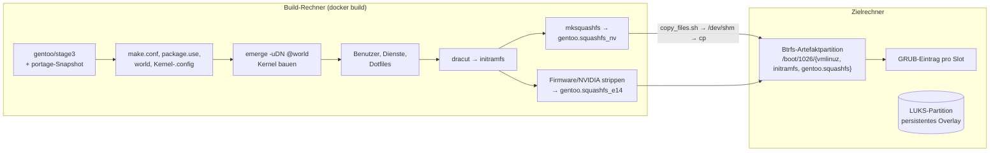
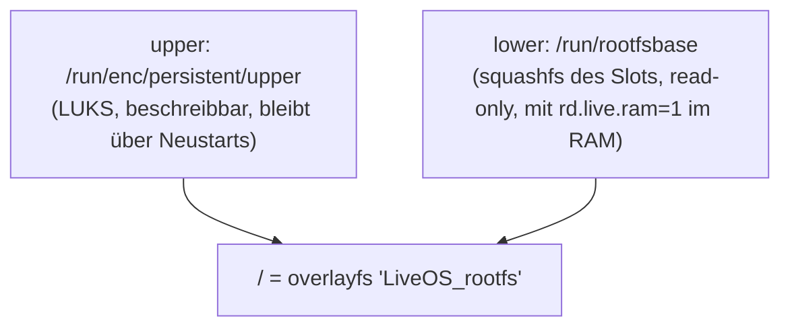
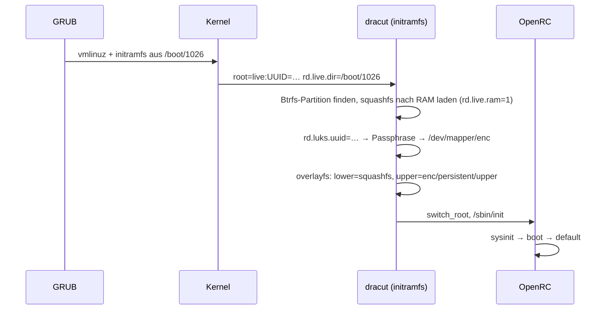
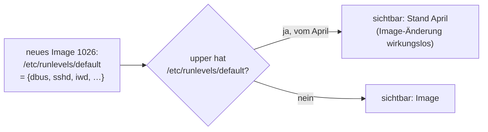
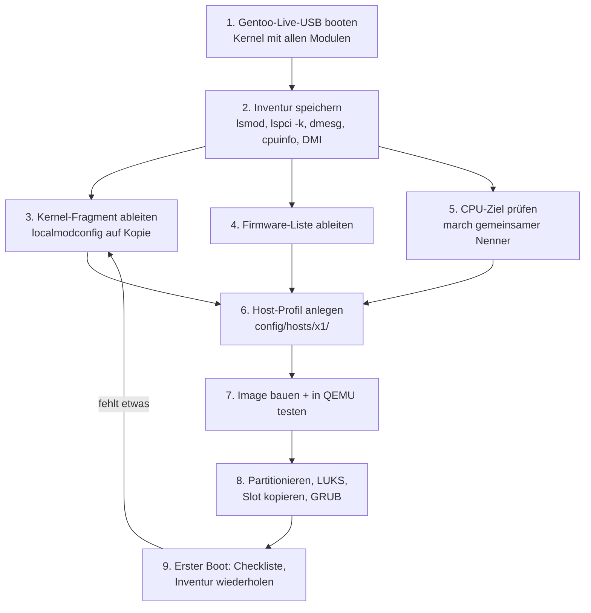
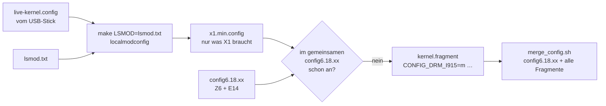
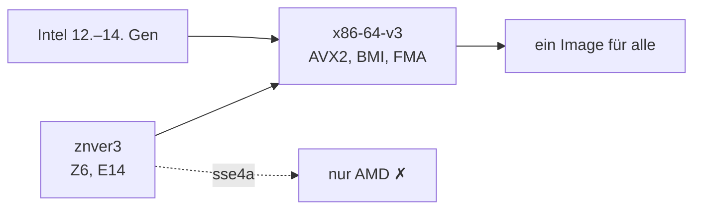

# Review: Dockerfile und Installationskonzept (openrc)

Dieses Review sieht sich das Konzept hinter `openrc/Dockerfile` und den
Installationsanleitungen (`install_on_hpz6.md`, `install_on_e14.md`) als
Ganzes an. Zuerst wird der Aufbau erklärt, damit die Befunde danach
verständlich sind. Danach folgen Stärken, priorisierte Befunde mit
Verbesserungsvorschlägen und eine Schritt-für-Schritt-Anleitung, wie man
einen neuen Rechner (z. B. ein Intel-ThinkPad) aufnimmt.

Stand: 2026-10-30, Dockerfile nach Commit `8f7877e5`.

## 1. Das Konzept in einem Bild

Das System wird nicht auf dem Zielrechner installiert, sondern in einem
Docker-Build erzeugt. Am Ende stehen drei Dateien: ein komprimiertes
Root-Dateisystem (squashfs), ein Kernel und ein initramfs. Sie werden in
einen datierten Ordner („Slot“) auf einer Boot-Partition kopiert, und GRUB
bekommt einen Eintrag dafür.



Beim Booten setzt dracut das Root-Dateisystem aus zwei Schichten zusammen.
Unten liegt das unveränderliche squashfs, darüber eine beschreibbare
Schicht auf der verschlüsselten Partition:



So läuft der Boot ab (vereinfacht, Parameter aus `/proc/cmdline`):



Dieses Muster kennt man von Live-CDs. Hier wird es mit Persistenz und
mehreren Slots nebeneinander betrieben, und das hat echte Vorteile.

## 2. Stärken

| Eigenschaft | Warum das gut ist |
| :--- | :--- |
| **Rollback per GRUB-Menü** | Jeder Slot ist ein vollständiges System. Startet `1026` nicht, wählt man `1009`. In `install_on_hpz6.md` ist das über Monate gepflegt worden. |
| **Build ohne Zielrechner** | Der Rechner läuft während des Builds weiter. Ein Fehlschlag kostet nur Build-Zeit. |
| **Unveränderliche Basis** | Das squashfs ist read-only. „Kaputtkonfigurieren“ betrifft nur das Overlay, und das lässt sich gezielt untersuchen (siehe 3.2). |
| **Schnelles System** | Mit `rd.live.ram=1` liegt das ganze Root im RAM. |
| **Varianten aus einem Build** | `squashfs_nv` (HP Z6, NVIDIA) und `squashfs_e14` (ThinkPad, AMD) entstehen aus demselben Paketstand. |
| **Messbar schlank** | `packages.tsv` mit Größe und Bauzeit pro Paket zeigt, wo sich Optimierung lohnt. |
| **Gut dokumentierte Firmware-Auswahl** | Für den E14 ist im Dockerfile begründet, welche Firmware warum dabei ist. Dieses Muster eignet sich als Vorlage für neue Rechner. |

## 3. Befunde

Die Befunde sind nach Wirkung sortiert. Jeder Punkt beschreibt die
Beobachtung, warum sie wichtig ist, und was man tun kann.

### 3.1 [hoch] Container-Annahmen rutschen ins echte System

**Beobachtung:** `gentoo/stage3` ist ein Container-Image und enthielt
`rc_sys="docker"`. Dadurch hat OpenRC auf echter Hardware udev, cgroups,
localmount usw. übersprungen. Das ist inzwischen behoben (siehe
[docker_data_disk_and_boot.md](docker_data_disk_and_boot.md)).

**Warum wichtig:** Es ist nur ein Beispiel für eine ganze Klasse von
Fehlern. Alles, was der Build in einer Container-Umgebung „sieht“, kann
falsch sein: `/run`, `/dev`, Hostname, `resolv.conf`, Zeitzone. Ein
Beispiel aus dem Dockerfile:

```dockerfile
 && install -d -o kiel -g kiel -m 0700 /run/user/1000
```

`/run` ist zur Laufzeit ein frisches tmpfs, das Verzeichnis gibt es nach dem
Boot also nicht mehr. Es schadet nicht, bewirkt aber auch nichts, und das
eigentlich zuständige `user-runtime` ist erst jetzt im Runlevel aktiv.

**Vorschlag:** Am Ende des Builds einen kleinen „Hardware-Realitätscheck“
einbauen, der solche Werte prüft:

```dockerfile
RUN grep -q '^rc_sys=""' /etc/rc.conf \
 && for s in udev cgroups localmount elogind docker; do \
      ls /etc/runlevels/*/"$s" >/dev/null || { echo "missing runlevel: $s"; exit 1; }; \
    done
```

### 3.2 [hoch] Das persistente Overlay überdeckt neue Images

**Beobachtung:** Jede Datei, die man auf dem Rechner einmal geändert hat,
liegt danach in `/run/enc/persistent/upper` und verdeckt für immer die
Version aus dem squashfs. Auf dem Z6 enthält `upper/etc` heute 94 Einträge.
Das Verzeichnis `/etc/runlevels/default` stammte noch vom April. Deshalb
wirkten `rc-update add dbus default` usw. aus dem Dockerfile hier nie.



**Warum wichtig:** Das ist der größte konzeptionelle Haken. Man baut ein
neues Image, testet es auf einer frischen Installation (E14, QEMU), und auf
dem Z6 passiert trotzdem nichts. Außerdem hängt das Overlay nicht an einem
Slot: Alle Slots teilen sich dasselbe `upper`. Ein Rollback auf `1009` nimmt
die Änderungen an `/etc` also nicht zurück.

**Vorschlag:**

1. Die Abweichungen sichtbar machen. Dieser Befehl lohnt sich nach jedem
   Deployment:
   ```sh
   # Dateien, in denen das Overlay das Image überdeckt
   sudo find /run/overlayfs/etc -type f -newer /run/rootfsbase/etc/os-release | head
   sudo diff -r /run/rootfsbase/etc /run/overlayfs/etc 2>/dev/null | less
   ```
2. Eine Regel festlegen: In `/etc` werden auf dem Rechner nur
   maschinenspezifische Dinge geändert (Schlüssel, UUIDs). Alles Allgemeine
   wird im Dockerfile geändert, und die überdeckende Kopie wird danach aus
   `upper` gelöscht.
3. Zum Ausprobieren eines Slots gibt es `rd.live.overlay.readonly=1`
   bzw. einen GRUB-Eintrag ohne `rd.overlay`. Das ist ein Boot mit
   unverändertem Image.

### 3.3 [hoch] Geheimnisse und Zugang

**Beobachtung A:** `setup01_build_image.sh` übergibt
`--build-arg TUNNEL_KEY="$(cat ~/.ssh/tinyus_key.pem)"` und
`INITRAMFS_AUTH_KEY`. Das Dockerfile deklariert beide nicht als `ARG`,
Docker ignoriert sie also und gibt nur eine Warnung aus.

**Warum wichtig:** Sobald jemand `ARG TUNNEL_KEY` ergänzt, steht der private
Schlüssel im Klartext in `docker history` und in jedem exportierten Image.
Build-Args sind nicht für Geheimnisse gedacht.

**Vorschlag:** Den Aufruf aus dem Skript entfernen. Wenn der Schlüssel
wirklich ins Image soll, gehört er in ein BuildKit-Secret:

```dockerfile
RUN --mount=type=secret,id=tunnel_key,mode=0400 \
    install -D -m 0400 /run/secrets/tunnel_key /etc/reverse-ssh/id_key
```
```sh
docker build --secret id=tunnel_key,src=$HOME/.ssh/tinyus_key.pem ...
```

Noch besser ist es, den Schlüssel gar nicht ins squashfs zu legen, sondern
nur ins verschlüsselte Overlay, genau wie `/etc/keys/dock.key`.

**Beobachtung B:** `passwd -d kiel` und `%wheel ALL=(ALL:ALL) NOPASSWD: ALL`.
Damit kann jeder an der Konsole ohne Passwort root werden. sshd lehnt leere
Passwörter standardmäßig ab, aus dem Netz ist das also nicht offen.

**Einordnung:** Das ist eine bewusste Bequemlichkeitsentscheidung, und sie
ist vertretbar, weil das Root-Overlay per LUKS geschützt ist. Ohne
Passphrase bootet das persistente System nicht. Man sollte das aber
irgendwo festhalten, damit es niemand für ein Versehen hält. Zusätzlich
sollte ein Test sicherstellen, dass `PermitEmptyPasswords no` gesetzt
bleibt.

### 3.4 [mittel] `-march=znver3` bindet das Image an AMD

**Beobachtung:** In `make.conf` steht
`COMMON_FLAGS="-O2 -march=znver3 -pipe"` und `CPU_FLAGS_X86` enthält
`sse4a`.

**Warum wichtig:** `znver3` erlaubt dem Compiler AMD-spezifische Befehle
(z. B. SSE4a). Auf einem Intel-Prozessor stürzen solche Programme mit
`Illegal instruction` ab, und das nicht beim Start, sondern irgendwann,
wenn die betroffene Codestelle läuft. Für den Z6 (Threadripper) und den E14
(Ryzen) passt der Wert, für einen Intel-ThinkPad nicht. Mehr dazu in
Abschnitt 4.

### 3.5 [mittel] Varianten entstehen durch Löschen im selben Layer

**Beobachtung:** Das NVIDIA-squashfs wird gebaut, indem die Firmware
gelöscht, das Image erstellt und die Firmware danach zurückkopiert wird.
Das E14-squashfs entsteht dann durch weiteres Löschen. Am Ende steht
`|| true`.

**Warum wichtig:**

- Die Reihenfolge ist entscheidend. Eine dritte Variante müsste wissen, was
  vorher gelöscht wurde.
- `|| true` verschluckt jeden Fehler, auch einen abgebrochenen
  `mksquashfs`. Der Build ist dann „grün“, aber `copy_files.sh` kopiert nichts
  oder ein altes Image.
- Die squashfs-Dateien (mehrere GB) liegen im Docker-Image selbst. Jeder
  Build belegt den Platz doppelt.
- `copy_files.sh` kopiert noch `/gentoo.squashfs`, das nicht mehr gebaut
  wird (Block auskommentiert).

**Vorschlag:** Mehrstufiger Build mit einer Stage pro Variante und direktem
Export über `--output`:

```dockerfile
FROM base AS rootfs            # alles bis vor mksquashfs

FROM rootfs AS strip-e14
RUN /usr/local/sbin/apply-host-profile e14     # Firmware-Liste, NVIDIA entfernen
RUN mksquashfs / /out/gentoo.squashfs ...

FROM scratch AS export-e14
COPY --from=strip-e14 /out/gentoo.squashfs /boot/vmlinuz /boot/initramfs*.img /
```
```sh
docker build --target export-e14 --output type=local,dest=/dev/shm/e14_$(date +%Y%m%d) .
```

Jede Variante geht dann von demselben unveränderten `rootfs` aus, ein Fehler
lässt den Build scheitern, und `copy_files.sh` sowie der privilegierte
`docker run` sind nicht mehr nötig.

### 3.6 [mittel] Maschinenwissen steckt verstreut im gemeinsamen Image

Was nur für einen Rechner gilt, steht an verschiedenen Stellen:

| Ort | Inhalt | gilt für |
| :--- | :--- | :--- |
| `Dockerfile` | `modules="amdgpu mt7921e"` | E14 |
| `config/xinitrc` | `xrandr --output DP-6 … DP-0 --rotate right` | Z6 (4 Monitore) |
| `config/activate` | `eno1`, `enp65s0`, statische IPs, `grep "ThinkPad E14"` | Z6/E14 |
| `config/40-touchpad.conf` | Touchpad | E14 |
| Dockerfile, E14-Block | Firmware-Liste | E14 |

Dazu kommt, dass das Skript auf dem Z6 (`/home/kiel/activate`) nicht mehr
mit `config/activate` übereinstimmt. `config_root` zeigt einmal auf
`docker_min_hpz6_openrc`, einmal auf `openrc/config`.

**Vorschlag:** Ein Verzeichnis pro Rechner, das sowohl der Build als auch
der Zielrechner liest:

```text
config/hosts/
├── hpz6/
│   ├── inventory/          # lsmod, lspci, dmesg, cpuinfo (siehe Abschnitt 4)
│   ├── kernel.fragment     # CONFIG_…-Zeilen, die dieser Rechner braucht
│   ├── firmware.list       # exakte Firmware-Pfade
│   ├── modules             # Inhalt für /etc/conf.d/modules
│   ├── network.env         # DHCP_IF=eno1, STATIC_IF=enp65s0, STATIC_ADDRS=…
│   └── xinitrc.local       # xrandr-Layout
├── e14/
└── x1/                     # neuer Rechner
```

`activate` und `.xinitrc` lesen dann beim Start
`/usr/local/share/hosts/$(cat /sys/class/dmi/id/product_name)/…`, und das
Image enthält alle Profile. Die DMI-Abfrage, die es in `activate` schon
gibt, wird damit zum Mechanismus für alle Rechner.

### 3.7 [mittel] Reproduzierbarkeit

| Stelle | Problem | Vorschlag |
| :--- | :--- | :--- |
| `FROM gentoo/stage3:nomultilib` | Tag ohne Datum, jeder Build nimmt die neueste Version | Datum pinnen wie bei `portage:20261028` |
| `git clone https://git.suckless.org/slstatus` | HEAD | `git checkout <commit>` |
| Emacs/MELPA | Paketstand vom Build-Tag | akzeptabel, aber im Build-Info vermerken |
| `config6.18.48` für Kernel `6.18.57` | `olddefconfig` setzt neue Optionen still auf Standardwerte | nach dem Build `make savedefconfig` zurück ins Repo schreiben, oder nur das Fragment pflegen |

### 3.8 [niedrig] Kleinigkeiten

- `RUN env-update && source /etc/profile` hat keine Wirkung. Jedes `RUN`
  startet eine neue Shell, und die exportierten Variablen gehen verloren.
  Gebraucht wird nur `env-update`, oder `ENV` für das, was dauerhaft gelten
  soll.
- Die Paketstatistik wird zweimal erzeugt (früh und spät). Die frühe
  Version kann weg.
- `COPY config/mount-overlayfs.sh /usr/lib/dracut/modules.d/70overlayfs`
  überschreibt eine Datei des dracut-Pakets. Benennt dracut sein Modul bei
  einem Update um, ist die Änderung still wirkungslos. Ein eigenes Modul
  (`modules.d/95kiel-overlay/`) und ein Test im Build wären robuster.
- `emerge -C rust-bin go …` nach dem Build: Ohne anschließendes
  `emerge --depclean -p` sieht man nicht, ob Laufzeitabhängigkeiten
  betroffen sind.
- `rc_verbose="YES"` und `rc_logger` sind für die Fehlersuche gut. Das
  Log `/var/log/rc.log` landet im Overlay und wächst dort ungebremst.

## 4. Einen neuen Rechner aufnehmen (Beispiel: Intel-ThinkPad)

Die Idee ist richtig: Zuerst bootet man ein System, dessen Kernel *alle*
Treiber hat. Damit sieht man, was die Hardware tatsächlich braucht. Danach
überträgt man genau das in das eigene Image.



### Schritt 1: Live-USB

Ein Gentoo-Minimal- oder LiveGUI-ISO auf einen Stick schreiben und davon
booten. Der Kernel dort ist eine `gentoo-dist`-Konfiguration, in der fast
alles als Modul gebaut ist. udev lädt dann genau die Module, die zur
erkannten Hardware passen.

```sh
dd if=install-amd64-minimal-*.iso of=/dev/sdX bs=4M status=progress oflag=sync
```

### Schritt 2: Inventur, bevor man irgendetwas installiert

`lsmod` zeigt nur, was **gerade** geladen ist. Bevor man die Inventur
speichert, sollte deshalb alles einmal benutzt worden sein:
Docking-Station und externe Monitore anstecken, USB-Ethernet einstecken,
WLAN scannen, Bluetooth einschalten, Ton abspielen, Webcam öffnen, einmal
Suspend/Resume. Sonst fehlt später genau das, was beim E14 als „USB-Adapter
war nicht eingesteckt“ dokumentiert ist.

```sh
#!/bin/sh
# inventory.sh – auf dem Live-System als root, Ziel: USB-Stick oder scp
H=x1; D=/mnt/usb/inventory-$H-$(date +%Y%m%d); mkdir -p "$D"
lsmod                         > "$D/lsmod.txt"
lspci -nnk                    > "$D/lspci.txt"        # Gerät + "Kernel driver in use"
{ lsusb -t; lsusb; }          > "$D/lsusb.txt"
dmesg                         > "$D/dmesg.txt"
grep -h . /sys/class/dmi/id/{sys_vendor,product_name,product_version} > "$D/dmi.txt"
cat /proc/cpuinfo             > "$D/cpuinfo.txt"
zcat /proc/config.gz          > "$D/live-kernel.config" 2>/dev/null
uname -r                      > "$D/uname.txt"
{ ip -br link; iw dev; }      > "$D/net.txt" 2>&1
{ aplay -l; arecord -l; }     > "$D/audio.txt" 2>&1
lsblk -o NAME,SIZE,TYPE,FSTYPE,MODEL > "$D/disks.txt"
# Firmware, die geladen wurde (ausführlich nur mit Debug-Meldungen)
dmesg | grep -iE 'firmware|loading' > "$D/firmware-dmesg.txt"
# Firmware, die die geladenen Module anfordern KÖNNTEN (Obermenge)
for m in $(lsmod | awk 'NR>1{print $1}'); do modinfo -F firmware "$m" 2>/dev/null; done \
  | sort -u > "$D/firmware-modinfo.txt"
# CPU-Fähigkeiten
/lib64/ld-linux-x86-64.so.2 --help | grep -A5 'Subdirectories' > "$D/x86-64-levels.txt"
gcc -march=native -Q --help=target 2>/dev/null | grep -E '^\s+-march=' > "$D/march-native.txt"
```

Die Ergebnisse kommen nach `config/hosts/x1/inventory/`.

### Schritt 3: Vom `lsmod` zum Kernel-Fragment

`make localmodconfig` liest eine `lsmod`-Liste und **schaltet jedes Modul
ab, das darin nicht vorkommt**. Auf die gemeinsame Konfiguration angewendet,
würde der Befehl den Z6 und den E14 kaputt machen. Deshalb nutzt man ihn
nur auf einer **Kopie** und auch nur, um herauszufinden, welche Optionen
gebraucht werden:



```sh
cd /usr/src/linux                       # gleiche Kernelversion wie im Image
cp hosts/x1/inventory/live-kernel.config .config
make LSMOD=hosts/x1/inventory/lsmod.txt localmodconfig
cp .config /tmp/x1.min.config

# Was braucht X1, das in der gemeinsamen Konfiguration fehlt?
grep -E '=(y|m)$' /tmp/x1.min.config | sort > /tmp/x1.on
grep -E '=(y|m)$' config/config6.18.48  | sed 's/=.*//' | sort > /tmp/shared.on
grep -v -F -f /tmp/shared.on /tmp/x1.on > config/hosts/x1/kernel.fragment
```

Für ein typisches Intel-ThinkPad (12.–14. Generation, Core Ultra) wird das
Fragment ungefähr so aussehen. In der heutigen `config6.18.48` fehlen diese
Optionen tatsächlich:

```text
CONFIG_DRM_I915=m            # Grafik bis Alder/Raptor Lake
CONFIG_DRM_XE=m              # Grafik ab Lunar/Arrow Lake
CONFIG_IWLWIFI=m
CONFIG_IWLMVM=m              # Intel-WLAN
CONFIG_E1000E=m              # Intel-Onboard-Ethernet (falls vorhanden)
CONFIG_SND_SOC_SOF_INTEL_TOPLEVEL=y
CONFIG_SND_SOC_SOF_PCI=m     # Ton über SOF (Mikrofon-Array)
CONFIG_INTEL_PMC_CORE=m      # S0ix/Modern Standby
CONFIG_MFD_INTEL_LPSS_PCI=m  # I2C für Touchpad
```

Vorhanden sind schon `THINKPAD_ACPI`, `INTEL_IDLE`, `X86_INTEL_PSTATE`,
`INTEL_IOMMU`, `BT_INTEL`, `I2C_HID_ACPI`, `HID_MULTITOUCH`, `USB4` und
`BLK_DEV_NVME`. Danach führt man das Fragment mit der gemeinsamen
Konfiguration zusammen und prüft, ob jede Option angekommen ist:

```sh
scripts/kconfig/merge_config.sh -m config/config6.18.48 config/hosts/*/kernel.fragment
make olddefconfig
for o in $(sed 's/=.*//' config/hosts/x1/kernel.fragment); do grep -q "^$o=" .config || echo "verloren: $o"; done
```

Meldet die Schleife „verloren“, fehlt eine Abhängigkeit, und
`make menuconfig` → `/` (Suche) zeigt, welche.

### Schritt 4: Firmware

Es gibt zwei Quellen, die man vergleicht:

- `firmware-dmesg.txt`: was wirklich geladen wurde. Das ist genau, aber
  meist unvollständig, weil die Meldungen nur mit `CONFIG_FW_LOADER_DEBUG`
  bzw. `dyndbg` erscheinen.
- `firmware-modinfo.txt`: was die Module laden *könnten*. Die Liste ist
  vollständig, aber zu groß (z. B. alle iwlwifi-Generationen).

Die Schnittmenge, ergänzt um das, was `dmesg` als fehlend meldet
(`failed to load`), kommt nach `hosts/x1/firmware.list`. Für Intel tauchen
typischerweise `i915/*` bzw. `xe/*`, `iwlwifi-*.ucode`, `intel/ibt-*`
(Bluetooth) und `intel/sof*` auf. Dazu kommen `sys-firmware/intel-microcode`
und `sys-firmware/sof-firmware` in `world`, dazu `VIDEO_CARDS="… intel"` in
`make.conf` für Mesa. Microcode lädt der E14 heute spät (`late loading`).
Für Intel ist das frühe Laden über dracut besser (`early_microcode=yes`),
das betrifft auch AMD.

### Schritt 5: Das CPU-Ziel

Ein gemeinsames Image für AMD und Intel braucht ein `-march`, das beide
können. Der Befehl aus der Inventur zeigt die unterstützten
x86-64-Level:

```text
x86-64-v4
x86-64-v3 (supported, searched)
x86-64-v2 (supported, searched)
```



Die Optionen:

1. **Ein Image für alle:** `-march=x86-64-v3 -mtune=generic`.
   `CPU_FLAGS_X86` wird dann die Schnittmenge aus `cpuid2cpuflags` auf allen
   Rechnern. Der Leistungsverlust gegenüber `znver3` liegt meist im
   einstelligen Prozentbereich. Diese Umstellung erzwingt einmal
   `emerge -e @world`.
2. **Eigener Build pro CPU-Familie:** eine zweite `make.conf` als Build-Arg.
   Das verdoppelt die Build-Zeit.

Für einen Laptop neben dem Z6 ist Option 1 die pragmatische Wahl.
Binärpakete (`getbinpkg`) sind ohnehin für generisches x86-64 gebaut.

### Schritt 6: Host-Profil

Im neuen Verzeichnis `config/hosts/x1/` (siehe 3.6) stehen außerdem: die
Module für `/etc/conf.d/modules`, die Netzwerkschnittstellen (bei Intel
z. B. `wlan0` über iwd, kein `eno1`), ein `xinitrc.local` mit dem
Monitor-Layout und ggf. Touchpad-Einstellungen. Im Dockerfile kommt eine
Stage `export-x1` dazu.

### Schritt 7: Erst in QEMU, dann auf der Hardware

Der E14 wurde schon einmal in QEMU hochgefahren (`install_on_e14.md`,
Abschnitt 3). Das prüft vor allem initramfs, Overlay und OpenRC, Treiber
dagegen nicht. Treiber testet man am schnellsten, indem man den neuen
Kernel samt initramfs auf dem Live-Stick bootet, mit `rd.live.dir` auf den
Slot zeigend und **ohne** `rd.overlay`. Dabei wird nichts geschrieben.

### Schritt 8: Installation

Wie in `install_on_e14.md`: EFI-Partition, eine Btrfs- oder ext4-Partition
für die Slots, eine LUKS-Partition für das Overlay. Dann den Slot kopieren
und den GRUB-Eintrag mit den eigenen UUIDs anlegen. Zuerst sollte man
`blkid` festhalten (wie Abschnitt 0 im E14-Dokument).

### Schritt 9: Abnahme nach dem ersten Boot

```sh
rc-status | grep -E 'stopped|crashed'          # sysinit/boot dürfen nichts zeigen
dmesg | grep -iE 'failed to load|firmware.*(missing|error)'
lspci -k | grep -A2 -E 'VGA|Network|Audio'     # jede Zeile hat "Kernel driver in use"
loginctl                                        # Session mit seat0
less /var/log/rc.log                            # OpenRC-Bootlog
```

Danach die Inventur aus Schritt 2 **auf dem eigenen System** wiederholen
und mit der Inventur vom Live-Stick vergleichen:

```sh
diff <(awk 'NR>1{print $1}' inventory-live/lsmod.txt | sort) \
     <(lsmod | awk 'NR>1{print $1}' | sort)
```

Jede Zeile mit `<` ist ein Modul, das unter dem Live-Kernel geladen war und
jetzt fehlt. Diese Module sind die Kandidaten für die nächste Runde von
Schritt 3.

## 5. Empfohlene Reihenfolge

1. Overlay-Drift sichtbar machen und `/etc` im Overlay aufräumen (3.2).
   Das bringt am meisten, weil Image-Änderungen dann wieder wirken.
2. `TUNNEL_KEY`-Build-Arg entfernen (3.3).
3. `|| true` am E14-Block entfernen, `copy_files.sh` an die tatsächlichen
   Artefakte anpassen (3.5).
4. Host-Profile einführen und die verstreuten Maschinenwerte dorthin
   ziehen (3.6). Das ist die Voraussetzung für einen dritten Rechner.
5. Vor dem Intel-Rechner: `-march` auf `x86-64-v3` umstellen und einen
   kompletten Rebuild einplanen (3.4).
6. Multi-Stage-Build mit `--output` (3.5), wenn ohnehin am Dockerfile
   gearbeitet wird.
