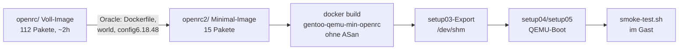
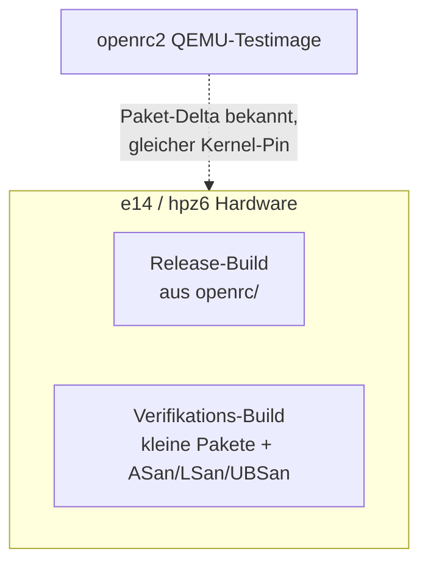

# Walkthrough: Minimales QEMU-Testimage (openrc2, ohne ASan)

Stand: 2026-10-24 — Build, QEMU-Boot, Login und Smoke-Test erfolgreich
abgeschlossen (Belege unten). Nächster Schritt: Sanitizer-Verifikationsbuilds.

## 1. Was exakt implementiert wurde

Ein neuer Ordner `openrc2/` neben dem unveränderten Voll-Image `openrc/`:

- **Welt auf 15 Pakete geschrumpft** (`config/world`, vorher 112): nur `sudo`,
  `sysklogd`, `gentoolkit` (für den Paket-Report), `git`, `picocom` (Pico-2-Seriell),
  `dhcpcd`, `pciutils`, `usbutils`, `cryptsetup`/`lvm2` (dracut-Kompatibilität),
  `dosfstools` (VFAT), `e2fsprogs`, `squashfs-tools`, `dracut`, Kernel-Pin.
  Gestrichen u. a.: Emacs, NVIDIA-Treiber, Mesa, Firefox/Signal, X11/dwm,
  WLAN/Audio/Drucker, dazu auf Wunsch `gdb`/`strace`, und implizit
  `llvm-core/llvm` (~395 MiB), das ohne Mesa/NVIDIA/Rust gar nicht erst in den
  Tree kommt.
- **Kernel per Fragment** (`config/kernel-qemu.fragment` auf Oracle-Kopie
  `config-base` = `../openrc/config/config6.18.48`): Virtio-Blk/Net/Console und
  serielle Konsole fest eingebaut; `DRM_AMDGPU`/`NOUVEAU`/`I915`, Sound, WLAN und
  Bluetooth abgeschaltet; **VFAT bleibt drin** (Pico-2-Entwicklung, vgl.
  `../openrc/plan/next.md`).
- **Ein einziges Squashfs** (`gentoo.squashfs_qemu`) statt NVIDIA- plus
  E14-Image; kein MELPA-Emacs-Run; dracut mit Virtio-Treibern.
- **QEMU-Werkzeuge:** `setup04_create_qemu.sh` (vfat-GRUB-Disk, angelehnt an
  `../docker_min/setup04_create_qemu.sh`), `setup05_run_qemu.sh` (`-nographic`,
  KVM mit TCG-Fallback, `--direct`-Modus ohne Disk-Image),
  `config/smoke-test.sh` (Gast-Test: Kernel, Root-Mount, Virtio, Netz, gcc,
  sshd, VFAT).
- **Leitplanken:** `tools/check-world-diff.sh` (world-mini gegen world-voll,
  verbotene Schwergewichte) und eine **Minimalitäts-Check-Stufe im Dockerfile**,
  die den Build abbrechen lässt, falls LLVM/NVIDIA/Mesa/Emacs/Firefox/Firmware
  doch landen.
- **Sanitizer vorbereitet, nicht aktiviert** (`config/env/sanitizers` mit
  `-fsanitize=address,undefined`; LSan steckt auf Linux in ASan): erst beweisen,
  dass minimal baut und bootet — Sanitizer-Builds brauchen deutlich mehr RAM
  und Zeit, deshalb zuerst Dependencies klein halten.

## 2. Architektur- und Design-Entscheidungen

- **Eigener Ordner statt `openrc/` zu ändern:** Das Voll-Image ist produktiv
  (e14/hpz6); Experimente fassen es nicht an. Gleicher Stage3-/Portage-Stand und
  gleicher `KVER_PURE`-Pin halten den Rückweg offen.
- **`VIDEO_CARDS` ganz gestrichen:** Ohne Xorg ist die Variable bedeutungslos;
  `LLVM_TARGETS="X86"` verhindert AMDGPU/NVPTX-Backends, falls doch einmal etwas
  LLVM ziehen will.
- **`package.env`/`low-mem` nur noch für gcc:** Der Rest kommt aus Binärpaketen
  (`getbinpkg`), deshalb ist der Minimal-Build weit unter den ~2h des Voll-Builds.
- **Kein LUKS/LVM in QEMU:** Die vfat-Disk aus `setup04` und der
  `--direct`-Start reichen für Tests; Verschlüsselung bleibt Hardware-Thema.
- **Build-Start sofort validiert:** Die ersten 10/40 Dockerfile-Stufen waren
  teils Cache-Treffer vom Host-Image, der Rest lief neu an (`COPY config/*`,
  `emerge gentoo-sources` als Binärpaket). Beleg: `openrc2/logs/setup01_run_20261024_051558.log`.
- **Spontan angepasst:**
  - `check-world-diff.sh` hatte zwei Bugs (kaputte Quote-Zeile, falscher Pfad) —
    behoben, jetzt grün. Der Paket-Report im Dockerfile braucht kein `genlop`
    mehr (keine Build-Zeiten) und `erofs-utils` entfiel ersatzlos.
  - **Boot-Bug (kritisch):** Erster Boot scheiterte mit dracut
    `Can't mount root filesystem`. Ursache per `rd.debug`-Trace + Initramfs-
    Autopsie gefunden: `config/mount-overlayfs.sh` (Hardware-Hook für
    LUKS/`/dev/mapper/enc`) wurde nach `/usr/lib/dracut/modules.d/70overlayfs`
    kopiert und **ersetzte dracuts Stock-Hook `mount/01-mount-overlayfs.sh`** —
    der Overlay-Mount nach `/sysroot` fand nie statt. Fix: Hook aus `openrc2/`
    gelöscht (liegt nur noch in `openrc/`), Stock-dracut mit tmpfs-Overlay
    nutzen. Rebuild (855 s) + Reboot = sauberer Boot.
  - **Netzwerk:** Erster Gast hatte nur `lo` (QEMU-Default-NIC e1000, kein
    Treiber im Minimal-Kernel). Fix: `-device virtio-net-pci -netdev user`
    in `setup05_run_qemu.sh` (beide Pfade); `VIRTIO_NET=y` war bereits im
    Fragment. Reboot-Beleg: `eth0` bekommt `10.0.2.15` via `dhcpcd`, Ping ok.
  - **`gdb`-Check entfernt:** `dev-debug/gdb`/`strace` wurden auf Wunsch
    gestrichen; der Smoke-Test prüft stattdessen `picocom` und die Abwesenheit
    der Schwergewichte (`no-heavyweights`).
  - **Alle 32 Threads genutzt:** `nproc`=32; `MAKEOPTS="-j32"`,
    `EMERGE_DEFAULT_OPTS="--jobs=32 --load-average=32"`, Kernel-`make -j32`,
    `mksquashfs: Using 32 processors` (Build-Log). QEMU-Gast läuft mit
    `-smp 16 -m 8G`.

## 3. Learnings, Belege & zukünftige Erweiterungen

- Größter Hebel ist nicht Kompilier-Parallelität, sondern Pakete ganz zu
  streichen: `linux-firmware` (~1841 MiB) + `nvidia-drivers` (~1083 MiB) allein
  sind über ein Drittel des Voll-Images (~8,4 GiB).
- **Build-Belege** (`openrc2/logs/setup01_run_20261024_054445.log`, exit 0,
  855 s): `Minimal-Check OK: kein LLVM/NVIDIA/Mesa/Emacs/Firefox/Firmware im
  Image.` Image `gentoo-qemu-min-openrc` 5,43 GB (Docker, inkl. Layer);
  `gentoo.squashfs_qemu` **416 MB** (E14-Image zum Vergleich: 1,3 GB).
- **Boot-/Gast-Belege** (QEMU `-smp 16`, KVM, serielle Konsole):
  `Linux 6.18.57-gentoo-dist`, 16 CPUs, Root `LiveOS_rootfs (overlay)`,
  358 statt 753 Pakete, `sshd: started`, passwortloser `kiel`-Login ok,
  `gcc 16.2.1` + `git` + `picocom` ok, `sudo -n` ok.
- **Smoke-Test: 10 PASS, 0 FAIL** (`kernel`, `root-mount`, `virtio-blk`,
  `network-tool`, `gcc`, `git`, `picocom`, `sshd-service`, `vfat-support`,
  `no-heavyweights`); Ping auf Gateway 0 % Verlust; `-fsanitize=address,
  undefined`-Testprogramm kompiliert und läuft (`SANITIZER_RUNTIME_OK`) —
  die Sanitizer-Laufzeit ist im Gast vorhanden, es fehlt nur noch der
  `package.env`-Eintrag für echte Verifikationsbuilds.
- **Bekannte Schönheitsfehler (Non-Goals):** `elogind` startet weder im Gast
  noch `user.kiel`-Service (`Cannot determine cgroup ... No medium found`,
  cgroup-frei im Live-Gast) — Login-Shell funktioniert trotzdem; `cfg80211`
  vermisst `regulatory.db` (kein WLAN in QEMU, harmlos).
- Erledigt: `package.env` enthält `net-dialup/picocom sanitizers` (wirksam ab
  nächstem Build); Live-Beleg im Gast: LSan `ERROR: LeakSanitizer: detected
  memory leaks` / `SUMMARY: 123 byte(s) leaked in 1 allocation(s)`, UBSan
  `runtime error: signed integer overflow: 2147483647 + 1 ...`.
- Danach: Rebuild mit Sanitizer-`picocom` + weitere kleine Pakete nachziehen.
- Langfristig: e14/hpz6-Release weiter aus `openrc/`; `openrc2/` als schnelle
  Test-Rampe davor.

## 4. Docker-Environment-Updates

Keine neuen Host-Pakete nötig: `qemu-system-x86`, `docker` (mit Socket) und
`grub-install`/`parted`/`qemu-img` (für `setup04`) sind in der
`03_ai_env`-Umgebung vorhanden bzw. per `apt-get` nachinstallierbar.
`openrc2/` selbst braucht keine `Dockerfile`-Änderung am Host-Image.

## Begriffs-Glossar

- **Squashfs:** Komprimiertes Nur-Lese-Dateisystem; das Gast-Root kommt daraus.
- **dracut/Initramfs:** Startumgebung, die Squashfs + Overlay mountet.
- **OverlayFS:** Stapel-Dateisystem für beschreibbare Schicht über Squashfs.
- **Virtio:** Paravirtualisierte QEMU-Geräte (Platte, Netz, Konsole) — schnell,
  keine HW-Treiber nötig.
- **ASan/LSan/UBSan:** Compiler-Sanitizer für Speicher-, Leak- und
  Undefiniert-Verhalten-Fehler (Verifikation, später).
- **KVM/TCG:** Hardware-Beschleunigung für QEMU bzw. reine Emulation als Fallback.

## Stapel-Status (Sanitizer-Rollout, Stand 2026-10-24)

Jeder Stapel wird erst per Docker gebaut/geprüft, dann muss er im QEMU-Gast
bis zum Login booten (Boot-Gate). Tag-Namen in Klammern.

| Stapel | Pakete | Stand |
|---|---|---|
| 01 (batch-01) | coreutils, util-linux, grep, sed | GRÜN: Run 23 (Docker 13/13), Gast-7 bis Login + SSH + Funktionstests |
| 02 (batch-02) | openrc | GRÜN: Run 35, Gast-18 bis Login + SSH (ohne Udev-Dienste) |
| 03 (batch-03) | dbus, elogind, openssh | GRÜN: Run 44, Gast-22 bis Login + SSH + uptime (mit System-Vorladung) |
| 04 (batch-04) | sudo, sysklogd, git, picocom, dhcpcd, pciutils, usbutils, cryptsetup, dosfstools, e2fsprogs, lvm2, squashfs-tools | GRÜN: Run 47, Gast-23 bis Login + SSH (git/usbutils Meson-Wrapper) |
| 05 | python (perl auf Hold) | BAUT (Run 50): Python in Run-49 belegt, Perl-Install braucht eigenen Hunt |
| 06 | bash, Interpreter-zuletzt (Plan) | offen, Patches bereit |

Gelerntes: LSan-Triage `exitcode=0` (nur Lecks melden); Preload-Trick für
Programme, die Sanitizer-Bibs per dlopen laden (udevd + libblkid); kein
Verschlüsselungsmodul in den Startdateien (Endlos-Schleife); Testmuster
müssen den Treffer wirklich enthalten; jede Bau-Kette mit Sanitizer-Tools
braucht den LSan-Export.
