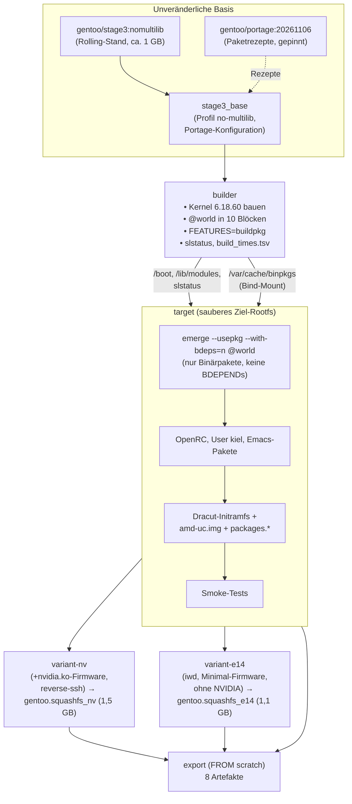
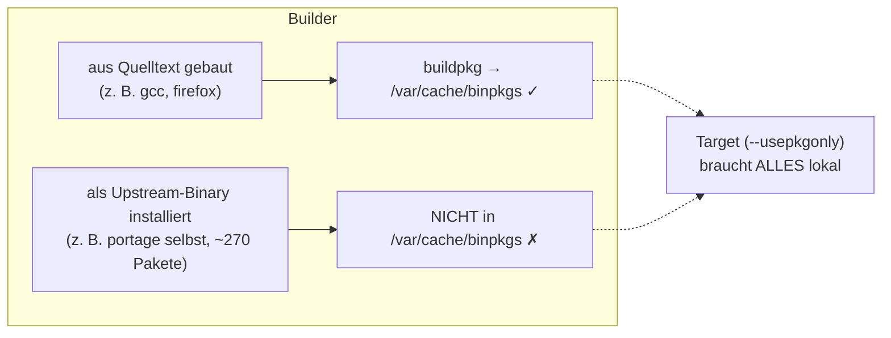
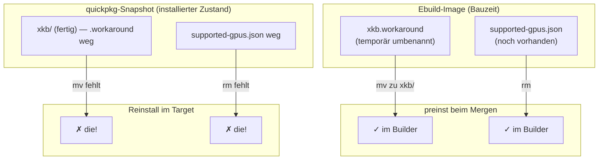

# Walkthrough: 2-Phasen-Gentoo-Build mit Binärpaketen (plan_fix2.md)

> Zielgruppe: alle, die verstehen wollen, **was** in diesem Umbau passiert ist, **warum**
> es an mehreren Stellen anders kam als geplant — und was wir daraus mitnehmen.
> Der Text setzt nur Grundkenntnisse in Linux und Docker voraus; Gentoo-Begriffe werden
> bei der ersten Verwendung erklärt. Alle Zahlen stammen aus dem echten Build vom
> 15.11.2026 (Build-Log `logs/setup01_run_20261115_042534.log`, Export-Verzeichnis
> `out_export/gentoo-z6-min-openrc_20261115/`).

## Glossar

| Begriff | Bedeutung |
| :--- | :--- |
| **Ebuild** | Bauanleitung für genau ein Paket im Gentoo-Quellbaum (vergleichbar mit einem Rezept: herunterladen, kompilieren, installieren). |
| **Portage** | Gentoo-Paketmanager (`emerge`). Löst Abhängigkeiten auf („Solver“) und baut aus Ebuilds. |
| **USE-Flag** | Schalter pro Paket oder global, der optionale Funktionen an-/abschaltet (z. B. `vaapi` = Hardware-Videobeschleunigung). Steht in `package.use` und `make.conf`. |
| **BDEPEND** | Build-Abhängigkeit: wird nur zum Kompilieren gebraucht (z. B. `rust`, `go`), nicht zur Laufzeit. |
| **`@world`** | Die Menge aller explizit gewünschten Pakete (`/var/lib/portage/world`) **plus** Systemsatz (`@system`: Compiler, C-Bibliothek …). |
| **Binpkg** | Fertig kompiliertes Paket (`.gpkg.tar`), das ohne Kompilieren installierbar ist. Liegt lokal in `/var/cache/binpkgs` (Variable `PKGDIR`). |
| **Binhost** | Server (oder Verzeichnis), von dem Portage fertige Binpkgs herunterladen kann. |
| **`--usepkgonly`** | Portage-Modus: *nur* Binärpakete verwenden, niemals aus Quelltext bauen. |
| **`quickpkg`** | Portage-Werkzeug, das aus *installierten* Dateien nachträglich ein Binpkg schnürt (ein „Foto“ statt einer sauberen Neuaufnahme). |
| **Stage3** | Minimal-Gentoo als Startpunkt jedes Builds (`gentoo/stage3:nomultilib`). |
| **Squashfs** | Stark komprimiertes, nur lesbares Dateisystem — hier das Format der ausgelieferten System-Images. |
| **Initramfs / Dracut** | Mini-System, das der Bootloader vor dem echten System startet (lädt Treiber, mountet Squashfs). `dracut` erzeugt es. |
| **OpenRC** | Init-/Service-Manager des Images (Alternative zu systemd). |
| **Solver / Backtracking** | Der Portage-Algorithmus, der aus allen Versionen und USE-Flags eine erfüllbare Kombination sucht; probiert bei Widersprüchen frühere Annahmen zurückzunehmen („Backtracking“). |
| **Merged-Usr** | Modernes Verzeichnislayout: `/bin`, `/sbin` und `/lib*` sind nur Symlinks nach `/usr/...`. Wichtig für Pfadangaben in Tests! |
| **preinst** | Skriptabschnitt eines Ebuilds, der *vor* dem Einspielen der Dateien läuft (z. B. legt Dateien um). |
| **Emerge-Log / Genlop** | `emerge.log` protokolliert jeden Paketbau; `genlop` liest daraus Bauzeiten aus. |

---

## Teil 1: Was exakt implementiert wurde

### 1.1 Das Ziel in einem Satz

Weg vom alten Ein-Stufen-Build (alles wird in einem einzigen, riesigen Container-Rootfs
kompiliert) hin zu einem **Zwei-Phasen-Binärpaket-Build**: Phase 1 kompiliert alles
*einmal* zu Binärpaketen, Phase 2 installiert daraus ein schlankes Zielsystem — ganz
ohne Compiler-Werkzeuge wie Rust oder Go im Endimage.

### 1.2 Die Architektur



**Lesart von oben nach unten:** Die Basis wird einmal aufgebaut und von beiden Phasen
identisch wiederverwendet. Der `builder` macht die ganze schwere Arbeit (kompilieren)
und legt jedes Ergebnis als Binärpaket ab. Der `target` fasst *nichts* mehr an, was
nach Compiler riecht: Er kopiert Kernel und Module aus dem Builder und installiert
den Rest ausschließlich aus dessen Binärpaketen — per Bind-Mount, also ohne Kopie.
Aus dem geprüften Target entstehen zwei Varianten (Arbeitsplatz-Rechner HP Z6 mit
NVIDIA-Grafik bzw. ThinkPad E14 mit Intel/AMD-Grafik und WLAN), und die
`export`-Stufe sammelt genau 8 Dateien ein.

### 1.3 Was in den Phasen 0–5 am Dateibaum geändert wurde

| Phase | Dateien | Kern der Änderung |
| :--- | :--- | :--- |
| 0 | `/tmp/openrc_cleanup_backup/` | Sicherung aller Skripte/Configs vor dem Umbau. |
| 1 | `config/host-reference/hpz6/`, `archive/`, `config-gentoo.sh`, `collect.sh` | HP-Z6-Reste und tote Skripte (`copy_files.sh`, Tunnel-Skripte, `NetworkManager.conf`) aussortiert; Analyse-Skript pfadunabhängig gemacht. |
| 2 | `package.use`, `package.accept_keywords`, `world`, `resolv.conf`, `make.conf` | USE-Duplikate (`lvm2`, `firefox`) zusammengeführt, `mesa -llvm` nach Solver-Test aktiviert, `dracut-crypt-ssh` und `gentoolkit` entfernt, `cmake` + `pkgconf` in `world` aufgenommen, Backtracking-Limits erhöht (Details in Teil 2). |
| 3 | `config/xinitrc`, `config/activate` | `xrandr` nur bei erkannten HP-Z6-Monitoren, OpenRC als alleiniger Sitzungs-Owner (kein `start-pipewire.sh` mehr), `activate` mit konfigurierbarem `STAGE_ROOT`, `tlp` nur auf dem E14. |
| 4 | `Dockerfile` (37 Builder- + 51 Target-Schritte) | Kompletter 2-Phasen-Umbau inkl. 10-Block-`@world`, `quickpkg`-Snapshot, Smoke-Tests, Varianten, `export`-Stufe. |
| 5 | `setup01_build_image.sh`, `setup03_copy_from_container.sh` | Secret-Übergaben (`INITRAMFS_AUTH_KEY`, `TUNNEL_KEY`) entfernt, Build-Argumente in `logs/last_build_args.env` zwischengespeichert (Cache-Treffer beim Export), Export-Basis per `EXPORT_BASE` wählbar (Container-`/dev/shm` ist meist zu klein). |

> **Beispiel — der 10-Block-`@world`-Trick:** Die 107 Atome aus `world` werden per
> `awk` von Kommentaren befreit und per `split -n l/10` auf zehn Blöcke verteilt.
> Jeder Block ist ein eigener Docker-Layer (`xargs -d '\n' -a /tmp/world_stage_00
> emerge -uDN`, …). Bricht Block 8 ab, bleiben die Blöcke 0–7 im Layer-Cache und
> müssen nicht neu gebaut werden. Genau das hat uns bei acht Fehlersuchen jeweils
> Stunden gespart: Nur der defekte Schritt lief neu, nicht der ganze Build.
> Ein abschließendes `emerge -uDN @world` („Konvergenz“) fängt danach alles ein,
> was zwischen den Blöcken noch offen war.

### 1.4 Was hinten herauskommt: die 8 Export-Artefakte

Der finale Build (`--target export --output …`, vollständig gecacht in ~2 Sekunden)
liefert exakt diese Dateien nach `out_export/gentoo-z6-min-openrc_20261115/`:

| Datei | Größe | Wozu |
| :--- | :--- | :--- |
| `gentoo.squashfs_nv` | 1,5 GB | Komplettsystem HP Z6 (NVIDIA-Treiber + Firmware, Reverse-SSH-Dienste). |
| `gentoo.squashfs_e14` | 1,1 GB | Komplettsystem ThinkPad E14 (Minimal-Firmware, `iwd`, ohne NVIDIA). |
| `vmlinuz` | 21 MB | Kernel 6.18.60 (generischer Name, siehe Teil 2.6). |
| `initramfs_squash_sda1-x86_64.img` | 14 MB | Dracut-Initramfs inkl. eigenem `70overlayfs`-Modul. |
| `amd-uc.img` | 299 KB | AMD-Microcode als separates Cpio-Archiv (wird beim Booten geladen). |
| `packages.txt` / `packages.tsv` | 44 / 16 KB | Paketbericht (Größe + Bauzeit, maschinen-/menschenlesbar). |
| `IMAGE-BUILD-INFO.txt` | 569 B | Git-Stand, Datum, Audio-Hinweis. |

### 1.5 Wo der Platz bleibt: die größten Pakete

Aus der echten `packages.tsv` (630 Pakete im Target):


*Abbildung 1: Installierte Größe der 15 größten Pakete. Drei Kernel-nahe Brocken
(`linux-firmware`, `gentoo-sources`, `nvidia-drivers`) dominieren mit zusammen
über 4,5 GiB — die eigentliche Firmware-Auswahl der E14-Variante (nur gelbe
`yellow_carp`- und `mediatek`-Dateien, siehe Firmware-Kommentare im Dockerfile)
spart dort fast 400 MB gegenüber der NV-Variante.*


*Abbildung 2: Die teuersten Kompilierläufe im Builder. `firefox` (~28 min),
`gcc` und `docker` (~19 min) sind der Grund, warum der Builder einmalig fast
zwei Stunden braucht — und warum es sich lohnt, das Ergebnis als Binärpakete
einzufrieren statt bei jedem Target-Build neu zu kompilieren.*

---

## Teil 2: Was Tests spontan anders erzwungen haben

Der Plan war an sieben Stellen zu optimistisch oder schlicht falsch. Jede Änderung
unten wurde durch einen **konkreten, beobachteten Fehler** ausgelöst — mit Log-Zitat
als Beleg. Das Muster dahinter steht in Teil 3.

### 2.1 Der Builder durfte seine eigenen Binärpakete nicht prüfen

**Symptom (Build-Log, Builder-Stufe):**

```text
>>> Creating binpkg
>>> Done.
* Binary package is not usable (verification failed):
* 	binpkg appears unsigned (missing any signature)
!!! Invalid binary package: '...binutils-libs-2.47-2.gpkg.tarnowaisyc.7'
```

**Ursache:** Die `make.conf` verlangt signierte Binärpakete
(`FEATURES=binpkg-request-signature`). Der Builder erzeugt mit `buildpkg` aber
unsignierte Pakete — ohne Signierschlüssel im Container schlägt die Verifikation
des *eigenen* frischen Pakets fehl, und der Merge bricht ab.

**Fix (eine Zeile im Builder):**

```dockerfile
RUN printf '\nFEATURES="${FEATURES} buildpkg -binpkg-request-signature"\n' >> /etc/portage/make.conf
```

Das `-` vor dem Feature-Namen schaltet nur die Signatur-*Anforderung* ab; die
finale `make.conf` im Image behält sie für den späteren Betrieb. Die Target-Stufe
übernimmt denselben Trick auf der Kommandozeile (der Plan hatte das bereits
vorgesehen — nur eben nicht für den Builder).

### 2.2 `make install` braucht `installkernel` (oder: das Rolling-Stage3 hat sich verändert)

**Symptom:** `make install` endete mit `Cannot find LILO.` und Exit-Code 1.
Der alte Build (Log vom 06.11.) zeigte dieselbe Meldung — aber mit Exit-Code 0.

**Ursache:** Ohne `/sbin/installkernel` fällt das Kernel-Installationsskript auf
einen Bootloader-Fallback zurück. Das alte (gepinnte) Stage3 brachte offenbar noch
einen funktionierenden Pfad mit; das aktuelle Rolling-Stage3 (`:nomultilib`,
*ungepinnt*!) enthält kein `installkernel` mehr.

**Fix:** `sys-kernel/installkernel` wird im Builder gleich zu Beginn mitinstalliert
(`emerge -1 sys-apps/portage sys-kernel/installkernel`). Verifiziert per
Test-Container: `/boot` enthielt danach `vmlinuz-6.18.60-gentoo-dist` (21 MB) und
`test -s` bestand.

> **Merksatz:** Alles, was *nicht* gepinnt ist (Stage3-Tag!), kann sich unter den
> Füßen ändern. Nur `gentoo/portage:20261106` ist per Datum festgenagelt.

### 2.3 Tippfehler mit Totalausfall: der fehlende Schrägstrich im `awk`

**Symptom:** Die World-Aufteilung brach sofort ab:

```text
awk: cmd. line:1: error: Unmatched ( or \(: /^[[:space:]]*(#|$) {gsub(/
```

**Ursache:** Beim Übertragen aus dem Plan war der schließende `/` des regulären
Ausdrucks verloren gegangen (`…($) {gsub…` statt `…)​/ {gsub…`). Ein einziges
Zeichen, Build-Stop nach ~5 Minuten Kernel-Arbeit.

**Fix:** Ein Zeichen ergänzt. Lehre daraus: Dockerfile-Zeilen, die länger als eine
Bildschirmbreite sind, verdienen einen eigenen Syntax-Test, bevor der 2-Stunden-Lauf
startet (siehe Teil 3, Vorschlag 2).

### 2.4 `tlp` und das abgeschaltete Python-Target

**Symptom (Chunk 8):**

```text
* No Python implementation selected for the build.
* ERROR: sys-power/tlp-1.9.1::gentoo failed (setup phase):
*   No supported Python implementation in PYTHON_SINGLE_TARGET.
```

**Ursache:** Unsere `package.use`-Zeile `sys-power/tlp -ppd
-python_single_target_python3_14 -rdw` schaltete das *einzige* verfügbare
Python-Target ab. Pakete mit `python-single-r1`-Eclass *brauchen* genau ein
aktives Target — ohne stirbt schon die Setup-Phase. Der Plan-Check (`emerge -p`,
nur „Trockenlauf“) konnte das prinzipiell nicht finden: Er prüft Auflösung, aber
führt keine Ebuild-Phasen aus.

**Fix:** `-python_single_target_python3_14` aus der `tlp`-Zeile gestrichen. Der
alte Build hatte übrigens versehentlich funktioniert, weil unser `package.use`
dort (aus einem anderen, historischen Grund) gar nicht gegriffen hatte — darauf
war kein Verlass.

### 2.5 Der Target fand keine Binärpakete: `quickpkg` schließt die Lücke

**Symptom (Target-Stufe):**

```text
emerge: there are no binary packages to satisfy "sys-apps/portage".
```

**Ursache (Datenfluss):**



Nur ~158 von ~430 Paketen landeten als Buildzeit-Binpaket im Cache — der Rest kam
fertig vom Gentoo-Binhost und wurde *nicht* lokal abgelegt. Der Target mit
`--usepkgonly` stand damit vor leeren Regalen.

**Fix:** Nach der Konvergenz läuft `quickpkg` über alle installierten Pakete und
schnürt Snapshots in `/var/cache/binpkgs`:

```dockerfile
RUN qlist -I | grep -v '^virtual/' | xargs quickpkg --include-config=y
```

(Virtuelle Pakete haben keine Dateien und werden übersprungen — dazu gleich mehr.)

### 2.6 Zwei Index-Fallen auf einmal: fehlende Einträge und `--usepkg`

Auch mit gefülltem Cache schlug der Target zweimal fehl — aus zwei verschiedenen
Gründen, die beide mit *Nachschlagen* zu tun haben:

**Falle A — der unvollständige Index.** `emaint --fix binhost` aktualisierte den
`Packages`-Index nur inkrementell und unterschlug stillschweigend drei Pakete
(`acct-user/messagebus`, `ntp`, `polkitd`), obwohl ihre `.gpkg.tar`-Dateien
vorhanden waren (817 statt 822 Einträge). **Fix:** Indexdateien vorher löschen und
von Grund auf neu erzeugen (`rm -f Packages*` vor `emaint`).

**Falle B — virtuelle Pakete.** `@world` enthält auch `@system` — und darin
Virtuelle wie `virtual/ssh` oder `virtual/package-manager`. Ein virtuelles Paket
hat nie ein Binärpaket, und unter `--usepkgonly` sind zusätzlich alle Ebuilds
maskiert: unlösbar. **Fix:** Target nutzt `--usepkg` statt `--usepkgonly`.
Verifiziert per Trockenlauf: *alle* echten Pakete kommen weiter aus lokalen
Binärpaketen, nur 16 virtuelle erscheinen als `[ebuild]` (sie installieren keine
Dateien). Der Plan-Text behielt `--usepkgonly` — die Korrektur steht als Kommentar
im Dockerfile.

> **Beispiel aus dem verifizierten Solver-Lauf:** `[binary N] x11-libs/libxkbcommon-1.13.2-4`,
> `[binary N] media-libs/libpng-1.6.59-r1-2 USE="apng …"`,
> `[binary R] sys-devel/gcc-16.2.1_p20260926-14` (`R` = Reinstall über das alte
> Stage3-System, gewollt). Kein einziges echtes Paket mit `[ebuild N]`.

### 2.7 Die Schnappschuss-Falle: wenn `preinst` ein Buildzeit-Relikt erwartet

**Symptom (Target, Paket 307 von 388):**

```text
rm: cannot stat '.../image/usr/share/nvidia/supported-gpus.json': No such file or directory
* ERROR: x11-drivers/nvidia-drivers-620.70.06::gentoo failed (preinst phase)
```

Kurz zuvor war `x11-misc/xkeyboard-config` am selben Muster gescheitert
(`cannot stat …/xkb.workaround`). Zwei Pakete, eine Ursache:



**Ursache:** Ein `quickpkg`-Snapshot fotografiert den *installierten* Zustand. Wer
— wie diese beiden Ebuilds — in `preinst` unbedingt eine Datei erwartet, die nur
*während* des Baus existiert, scheitert beim Wiedereinspielen. Ebuilds aus
Quelltext-Builds (`buildpkg`) haben dieses Problem nie: Sie enthalten das
Buildzeit-Layout.

**Fix (zweistufig):**
1. `quickpkg` läuft nur noch für Pakete, die *kein* Buildzeit-Binpaket haben
   („das echte Binpaket gewinnt immer“). Damit war `nvidia-drivers` geheilt —
   dessen Quell-Binpaket lag bereits im Cache.
2. `xkeyboard-config` kam nur als Upstream-Binary (kein lokales Buildzeit-Binpaket)
   und bekam deshalb einen erzwungenen Quell-Rebuild in ein leeres `PKGDIR`:

```dockerfile
RUN rm -f /var/cache/binpkgs/x11-misc/xkeyboard-config/*.gpkg.tar \
 && mkdir -p /tmp/empty-pkgdir \
 && PKGDIR=/tmp/empty-pkgdir FEATURES="-getbinpkg" \
      emerge -1 --buildpkg =$(qlist -Iv x11-misc/xkeyboard-config) \
 && cp /tmp/empty-pkgdir/x11-misc/xkeyboard-config/*.gpkg.tar \
      /var/cache/binpkgs/x11-misc/xkeyboard-config/
```

Verifiziert: Das neue Binpaket enthält `image/usr/share/X11/xkb.workaround` —
die `preinst`-Umbenennung läuft wieder ins Leere… pardon, ins Volle.

> **Audit:** Alle 47 installierten Pakete mit `pkg_preinst`/`pkg_prerm` wurden
> geprüft; das Muster „unbedingtes `mv`/`rm` einer nur zur Bauzeit existierenden
> Datei“ kommt im ganzen Snapshot genau einmal vor (`xkeyboard-config`). Der
> Rest arbeitet entweder auf dem Live-System (`EROOT`, bewacht) oder mit
> `||`-freien, idempotenten Operationen.

### 2.8 Der generische Kernelname: `vmlinuz` vs. `vmlinuz-6.18.60-gentoo-dist`

**Symptom (Smoke-Test, allerletzte Prüfung vor den Varianten):** Kein Fehlertext —
die Kette aus `test -s`-Prüfungen schweigt bei Fehlschlag. Erst die Einzelprüfung
im Debug-Target zeigte: `test -s /boot/vmlinuz` scheiterte, denn `make install`
legt mit `installkernel` nur versionierte Namen an.

**Fix — bewusst in der Target-Stufe** (statt im Builder, um dessen Layer-Cache
nicht zu entwerten):

```dockerfile
COPY --from=builder /boot /boot
...
RUN cp /boot/vmlinuz-${KVER_RELEASE} /boot/vmlinuz && test -s /boot/vmlinuz
```

Ein Folgefehler im Plan-Check wurde nebenbei gefunden: Der
Squashfs-Stichprobentest suchte `nvidia.ko` unter `lib/modules` — auf
Merged-Usr-Systemen ist `/lib` aber nur ein Symlink; korrekt ist
`usr/lib/modules`. Das Image war fehlerfrei, der Testpfad war es nicht.

---

## Teil 3: Learnings und mögliche Erweiterungen

### 3.1 Fünf Learnings aus acht Build-Abbrüchen

1. **Trockenläufe lügen nie, aber sie verschweigen viel.** `emerge -p`
   (Preflight aus Phase 2) beweist Auflösung — nicht Installierbarkeit.
   `pkg_setup`-/`preinst`-Fehler (`tlp`, `xkeyboard-config`, `nvidia`) treten erst
   beim echten Merge auf. *Konsequenz:* Kritische Pfade (Target-Install, Smoke-Test)
   immer einmal real durchlaufen lassen, nie nur „planen“.
2. **Fehlermeldungen zeigen gern auf Unschuldige.** Die `libxkbcommon`-Maskierung
   („masked by: use flag configuration mismatch“) war ein Artefakt abgebrochenen
   Backtrackings, keine echte USE-Kollision — mit `--autounmask-backtrack=y`
   löste dieselbe Konfiguration fehlerfrei auf. *Konsequenz:* Bei Solver-Fehlern
   erst das Backtracking-Limit erhöhen (`--backtrack=30`), dann die USE-Flags
   anfassen.
3. **Fotos sind keine Negative.** `quickpkg`-Snapshots sind bequem, aber kein
   Ersatz für Buildzeit-Binpakete, sobald `preinst` Bauzeit-Zustand erwartet.
   *Konsequenz:* Snapshots nur als Lückenfüller; wo ein echtes Binpaket existiert,
   gewinnt es.
4. **Inkrementelle Indizes können still lügen.** Ein vorhandener `Packages`-Index
   wird nicht unbedingt vollständig ergänzt (3 von 822 Einträgen fehlten ohne
   Fehlermeldung). *Konsequenz:* Generierte Indizes vor dem Regenerieren löschen.
5. **Nur Gepinntes ist reproduzierbar.** Portage-Snapshot per Datum gepinnt ✓,
   Stage3-Tag rolling ✗ — genau dort kam die `installkernel`-Überraschung her.
   *Konsequenz:* Entweder auch Stage3 per Digest pinnen oder (besser) die
   Annahme „frisches Stage3 enthält X“ durch explizites Emergen ersetzen —
   so wie jetzt mit `installkernel` geschehen.

### 3.2 Vorschläge für die Zukunft (bewusst nicht umgesetzt)

| Nr. | Idee | Erwarteter Nutzen | Aufwand/Risiko |
| :--- | :--- | :--- | :--- |
| 1 | Stage3 per Image-Digest pinnen (`stage3@sha256:…`) | Voll reproduzierbare Builds, keine Rolling-Überraschungen mehr | Klein; Digest bei Bedarf aktualisieren |
| 2 | `Dockerfile --check` / Shell-Syntax-Tests für lange RUN-Zeilen in CI | Tippfehler wie der `awk`-Slash fallen vor dem 2-h-Lauf auf | Klein (`bash -n`, `awk --lint`) |
| 3 | Builder-Binpkgs signieren (eigener Schlüssel, Target vertraut ihm) | `binpkg-request-signature` durchgehend aktiv, kein Sonderweg | Mittel; Schlüsselverwaltung nötig |
| 4 | `ccache` im Builder für Kernel-/Chunk-Rebuilds | Schnellere Iterationen bei Dockerfile-Änderungen hinter dem Kernel-Schritt | Mittel; Cache-Volumen + Korrektheit prüfen |
| 5 | `emerge -p` des *kompletten* Targets in die Preflight-Phase aufnehmen | Solver-Probleme der Target-Stufe (`virtuals`, USE-Mismatch) vor dem Build sichtbar | Klein; ~1 Minute mit gecachtem Check-Image |
| 6 | E14-Boot-Test automatisieren (QEMU mit den exportierten Artefakten) | Echte Boot-Verifikation ohne Hardware vor Ort | Groß; QEMU + OVMF + virtio-Setup nötig |
| 7 | Profil- und Snapshot-EOL per Cron prüfen | Frühwarnung, wenn `23.0/no-multilib` oder der Snapshot ausläuft | Klein; monatlicher CI-Job |

---

## Teil 4: Neue Programme und Pakete für den Docker-Container

Bewusst sparsam: Jedes zusätzliche Paket im Image will gepflegt, signiert und
aktualisiert werden. Aufgenommen wurde nur, was einen belegten Zweck erfüllt —
alles andere bleibt bewusst draußen.

### 4.1 Dauerhaft aufgenommen (mit Begründung und Beleg)

| Paket | Wo | Warum (mit Beleg) |
| :--- | :--- | :--- |
| `sys-kernel/installkernel` | Builder (explizit), **Empfehlung: zusätzlich in `world`** | Ohne das Paket scheitert `make install` auf aktuellem Stage3 (`Cannot find LILO.`, Exit 1, Build-Log 03:35). Der Builder braucht es heute; das *laufende* System braucht es morgen (nächstes Kernel-Update würde sonst genauso scheitern). |
| `dev-build/cmake` | `world` | Neu in `world`: Target installiert `cmake-4.3.4` als Binpaket (`packages.tsv` verifiziert). Wird von `firefox`-, `llvm`- und diversen Builds als BDEPEND-nahe Laufzeit gebraucht; bei `--with-bdeps=n` muss es explizit in `world` stehen, sonst fehlt es im Zielsystem. |
| `dev-util/pkgconf` | `world` | Gleiche Begründung wie `cmake`; `pkgconf` ist der Standard-`pkg-config`-Nachfolger und von dutzenden Ebuilds vorausgesetzt. |

### 4.2 Bewusst nur temporär (nicht im Image)

| Paket | Wo | Warum nur temporär |
| :--- | :--- | :--- |
| `app-portage/genlop` | Builder, `--oneshot` | Liest Bauzeiten aus `emerge.log` für `packages.tsv`. Würde im Target nur `perl` + Ballast mitziehen; nach Gebrauch nicht einmal deinstalliert nötig (Builder-Layer wird verworfen). |
| `sys-kernel/gentoo-sources` | Builder | Reine Bauzeit-Quelle; ins Target wandern nur kompilierte Artefakte (`/boot`, `/lib/modules`). |

### 4.3 Bewusst draußen (Design-Entscheidung, verifiziert)

| Paket | Status | Begründung |
| :--- | :--- | :--- |
| `dev-lang/rust`, `dev-lang/go`, `app-portage/gentoolkit` | Nicht in `world`, Smoke-Test prüft Abwesenheit | Reine BDEPENDs (`rustc`/`cargo`/`go` fehlen im Image, verifiziert). Das *ist* der Sinn der 2-Phasen-Architektur: Build-Werkzeuge bleiben im Builder. |
| `dev-lang/rust-bin` (Binary) | Nur Builder | Wird dort für `firefox` & Co. gebraucht; landet als Binpaket im Cache, aber `--with-bdeps=n` hält es aus dem Target fern. |
| `x11-drivers/nvidia-drivers`, `dev-util/nvidia-cuda-toolkit` | Nur Builder + `variant-nv` | In `variant-e14` explizit entfernt (`emerge -C` + gezieltes `rm`, *kein* wildes `libnv*`-Löschen — das hatte früher `libnvme` und damit `nvme-cli` zerstört). |

### 4.4 Offene Empfehlung: `installkernel` in `world` aufnehmen?

Heute steht `installkernel` nur in der Builder-Zeile (`emerge -1 …`, also ohne
`world`-Eintrag). Das genügt für den Image-Bau. Sobald aber auf dem *laufenden*
System jemals ein Kernel neu gebaut wird (Update 6.18 → 6.19), schlägt dort
`make install` aus demselben Grund fehl wie hier im Builder. Ein einzeiliger
`world`-Eintrag schließt die Lücke dauerhaft — Aufwand minimal, Risiko keines
(kleines, wartungsarmes Paket). Noch nicht umgesetzt, weil kein laufendes System
zum Gegenprüfen zur Verfügung stand.

---

## Anhang A: Verifikationsergebnisse (15.11.2026)

Build-Log: `logs/setup01_run_20261115_051847.log` (`exit_code=0` in `.meta`, Dauer 1045 s dank Layer-Cache),
Export: `out_export/gentoo-z6-min-openrc_20261115/`.

| Prüfung (Plan Phase 6) | Ergebnis |
| :--- | :--- |
| 8 Artefakte vorhanden und nicht leer | ✓ `vmlinuz`, beide Squashfs, Initramfs, `amd-uc.img`, `packages.txt/tsv`, `IMAGE-BUILD-INFO.txt` |
| `cmake`, `pkgconf`, `gdb`, `sbcl` in `packages.tsv` | ✓ |
| Kein `rust`/`go`/`gentoolkit` in `packages.tsv` | ✓ |
| E14: `libnvme.so` vorhanden, kein `nvidia-smi` | ✓ |
| E14: `etc/iwd/main.conf` + `etc/conf.d/modules` vorhanden, kein `reverse-ssh-eu` | ✓ |
| NV: `reverse-ssh-eu` + `nvidia.ko` vorhanden (`usr/lib/modules`, Merged-Usr beachten!) | ✓ |
| Smoke-Test im Target (Runlevel, 18 Binaries, `BAT0`, kein BDEPEND-Werkzeug, Initramfs, Microcode) | ✓ (nach `vmlinuz`-Fix) |
| `install_on_e14.sh --dry-run` auf dem ThinkPad E14 | Ausstehend (Zielhardware, nicht in dieser Umgebung prüfbar) |

## Anhang B: Geänderte Dateien im Überblick

`Dockerfile` (2-Phasen-Umbau + 6 dokumentierte Fixes), `config/etc/portage/{package.use,make.conf,package.accept_keywords}`,
`config/var/lib/portage/world`, `config/{xinitrc,activate,config-gentoo.sh,resolv.conf}`,
`setup01_build_image.sh`, `setup03_copy_from_container.sh`, `collect.sh` (neu),
`config/host-reference/hpz6/` + `archive/` (Aussortiertes), dieser Bericht +
`img_top15_size.png`, `img_top15_buildtime.png`.

*Backup vor dem Umbau (`/tmp/openrc_cleanup_backup`) und `out_export/` erst nach
erfolgreichem Boot-Test auf dem E14 löschen — so steht es im Plan, und dabei
bleibt es.*
