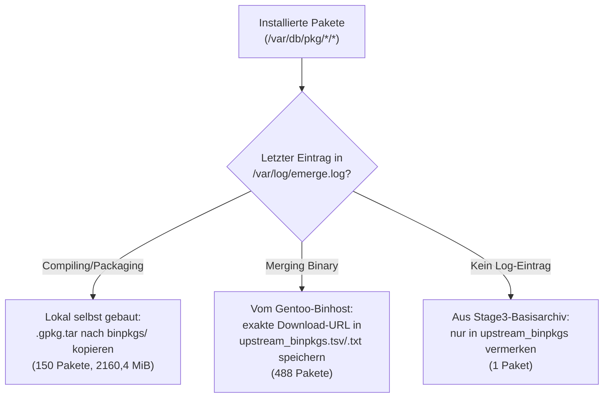
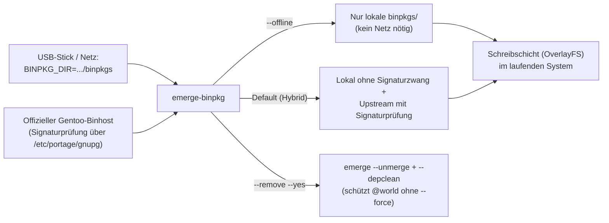

Hier ist zunächst ein technisches **Review** des aktuellen Quellcodes, der Skripte und des bisherigen `walkthrough.md`, gefolgt vom komplett überarbeiteten **`plan/20261115_01_review/walkthrough.md`** zum direkten Übernehmen.

---

## Teil 1: Review des Quellcodes, der Skripte und des bisherigen `walkthrough.md`

### 1.1 Was technisch sehr sauber gelöst ist
* **Saubere Trennung in `builder` → `target` → Varianten (`Dockerfile`):** `extract_local_binpkgs.py` läuft im `builder` *nach* dem `xkeyboard-config`-Quell-Rebuild und *vor* `quickpkg` und `genlop`. Dadurch bleiben `quickpkg`-Snapshots strikt auf `/tmp/target-binpkgs` beschränkt und `genlop` (mit `FEATURES="-buildpkg"`) verschmutzt den Export nicht.
* **Zuverlässiger Klassifikator (`config/extract_local_binpkgs.py`):** Die Erkenntnis aus Phase 1.2, dass Portage `BINPKGMD5` auch bei eigenen Quellbuilds schreibt und im Log `Compiling/Packaging` bzw. `Merging Binary` verwendet, ist sauber umgesetzt. Der Download des Upstream-`Packages`-Index vom `sync-uri` (mit Cache-Fallback) macht die URL-Auflösung robust.
* **Keyring-Export für Hybrid-Installation (`Dockerfile`):** Das Kopieren von `/etc/portage/gnupg` vom `builder` ins `target` inkl. Entfernen von `S.*`/`.#*` und `chmod 0755`/`0644` (weil Portage Signaturen als unprivilegierter Benutzer `portage` prüft) löst das `NO_PUBKEY`-Problem sauber.
* **`/etc/hosts` über `mksquashfs -p`:** Da Docker `/etc/hosts` read-only einhängt, umgeht `-p "/etc/hosts f 0644 0 0 cat /tmp/hosts.variant"` zusammen mit `-e etc/hosts` das Build-Problem ohne Umwege.
* **Cache-Erhalt beim Export (`setup01_build_image.sh` + `setup03_copy_from_container.sh`):** Durch `logs/last_build_args.env` bekommt auch der separate Export-Aufruf in `setup03` identische `BUILD_*`-Args und trifft den BuildKit-Cache.
* **E14-Deployment (`install_on_e14.sh`):** UUID-basiertes Mounten, Platzprüfung mit Sicherheitspuffer, Schutz des aktuell gebooteten Slots, SHA-256-Verifikation und bewusster Verzicht auf `binpkgs/` auf `/1p2`.

### 1.2 Konkrete Befunde im Quellcode und in den Skripten

| Prio | Fundstelle | Befund & Auswirkung | Empfohlener Fix |
| :--- | :--- | :--- | :--- |
| **Mittel** | `Dockerfile` (`/etc/local.d/10-hosts.start`, Zeile 187–194) | **Regex-Bug bei Tab-Einrückung:** In `variant-nv` und `variant-e14` wird `/etc/hosts` per `printf '127.0.0.1\te14 localhost\n...'` (mit **Tab** `\t` zwischen IP und Hostname) erzeugt. `10-hosts.start` prüft aber mit `grep -Eq "^127\.0\.0\.1[[:space:]].* ${h}( |$)"`. `[[:space:]]` schluckt das Tab, danach verlangt `.* ` zwingend ein **Leerzeichen** vor `${h}`. Der Check schlägt also immer fehl und schreibt `/etc/hosts` beim Booten unnötig ins persistente Overlay (`upper`). | Regex auf `^127\.0\.0\.1([[:space:]].*)?[[:space:]]${h}([[:space:]]|$)` ändern. |
| **Mittel** | `config/emerge-binpkg` (`--list` & `--remove`) | **1) `--list` zeigt CPVs mit Version** (z. B. `app-misc/jq-1.8.1`), während `emerge-binpkg <paket>` ein Atom ohne Version (oder mit `=`-Präfix) erwartet. Wer eine Zeile aus `--list` direkt kopiert, bekommt einen `emerge`-Fehler.<br>**2) `--remove`** prüft `@world` per `grep -qx "${a}"`. Bei eingeschränkten Atomen in `world` (z. B. `<sys-kernel/gentoo-sources-6.19`) greift der Schutz bei `emerge-binpkg --remove sys-kernel/gentoo-sources` nicht. | In `--list` zusätzlich den reinen Paketnamen (`CP`) oder direkt den `=CPV`-Aufruf anzeigen (oder im Skript automatisch `=` voranstellen, wenn eine Version angehängt ist). Für `--remove` ggf. `grep -qE "(^|[<>=~])${a}(-[0-9]|$)"` prüfen. |
| **Niedrig** | `config/emerge-binpkg` & `doc/binpkg_overlay_usage.md` | **Signatur-Erklärung leicht missverständlich:** `emerge-binpkg` setzt global `FEATURES="-binpkg-request-signature"`. Dass Upstream-Pakete im Hybrid-Modus trotzdem per `/etc/portage/gnupg` signaturgeprüft werden (belegt durch `NO_PUBKEY` in `evidence.md` 4d), liegt an `verify-signature = true` pro Repo in Portages `binrepos.conf`, nicht an `FEATURES`. | Kommentar im Skript und in `doc/binpkg_overlay_usage.md` dahingehend präzisieren. |
| **Niedrig** | `Dockerfile` (`variant-e14`, Zeile 527) | **`packages.txt`/`packages.tsv` spiegelt `target`, nicht `variant-e14`:** `variant-e14` installiert `net-dns/openresolv` nach und entfernt `x11-drivers/nvidia-drivers`. Die exportierten `packages.*` kommen aber aus `target` (enthalten also noch `nvidia-drivers` und kein `openresolv`). | Ist akzeptabel, solange es dokumentiert ist; alternativ pro Variante ein `packages_<var>.txt` erzeugen oder in `IMAGE-BUILD-INFO.txt` erwähnen. |
| **Niedrig** | `config/etc/portage/make.conf` (`EMERGE_DEFAULT_OPTS`) | `EMERGE_DEFAULT_OPTS="--jobs=32 --load-average=32 ..."` gilt über das Image auch auf dem E14. Für Binpkgs unproblematisch; falls dort mit `emerge` doch einmal aus Quellen gebaut wird, kann `-j32` RAM-Druck erzeugen. | So belassen (solange `binpkgs` genutzt werden) oder im `target` `MAKEOPTS`/`--jobs` bei Bedarf moderater setzen. |

### 1.3 Warum das bisherige `plan/20261115_01_review/walkthrough.md` schwer verständlich war
1. **Telegramm- und Agenten-Jargon:** Formulierungen wie *„150 Dateien, 2160,4 MiB, Dateianzahl = Index-Einträge“*, *„xkeyboard-Rebuild → Export nach /out_binpkgs → Kopie nach /tmp/target-binpkgs + quickpkg dort“* oder *„qlist | grep -q unter pipefail stirbt an SIGPIPE“* erklären nicht, **was** passiert und **warum** es nötig war.
2. **Fehlende Kausalketten:** Warum führt ein `quickpkg`-Snapshot von `xkeyboard-config` oder `nvidia-drivers` zu einem kaputten Binpkg? Warum enthält `/var/db/pkg` bei *allen* Paketen eine `BINPKGMD5`? Warum scheitert `emerge --usepkgonly` an `@world`, während `--usepkg` klappt? Diese zentralen Zusammenhänge fehlten.
3. **Kaum nutzbare Praxis-Beispiele:** Es gab kein konkretes Beispiel, wie man das neue `binpkgs/`-Verzeichnis am laufenden E14 oder HP Z6 per USB/Netz tatsächlich benutzt.
4. **Unvollständiges Glossar & knappe Paketliste:** Abkürzungen wie `CPV`, `VDB`, `NVPTX`, `Dracut`, `Initramfs`, `SIGPIPE` wurden vorausgesetzt; die Paketliste am Ende war nur ein unübersichtlicher Fließtext.

---

## Teil 2: Überarbeitetes `plan/20261115_01_review/walkthrough.md`

Der folgende Block kann 1:1 als neue Datei `plan/20261115_01_review/walkthrough.md` gespeichert werden:

```markdown
# Walkthrough: Lokale Binärpakete exportieren, im laufenden System nachinstallieren und Image-Rebuild (2026-11-15)

Dieses Dokument erklärt Schritt für Schritt, wie der Gentoo-OpenRC-Build vom 15.11.2026 aufgebaut wurde, wie das Nachinstallieren von Build-Werkzeugen über lokale Binärpakete funktioniert und warum einzelne Teile während der Tests umgebaut werden mussten.

Alle konkreten Zahlen, Dateigrößen, Prüfsummen und Log-Auszüge in diesem Dokument stammen aus den überprüften Messdaten in [evidence.md](evidence.md).

---

## Glossar

* **Atom:** Ein Paketname in Gentoo ohne konkrete Versionsnummer (z. B. `dev-build/cmake`).
* **BDEPEND (Build-Dependency):** Ein Programm oder eine Bibliothek, die nur während des Kompilierens gebraucht wird (z. B. der Go-Compiler `dev-lang/go` oder der Rust-Compiler `dev-lang/rust`), im fertigen laufenden System aber nicht mehr liegen muss.
* **Binhost:** Ein Webserver, von dem Gentoo bereits fertig kompilierte Pakete herunterladen kann (hier der offizielle Gentoo-Binhost).
* **BINPKG (Binärpaket):** Ein fertig kompiliertes Paket-Archiv im Format `.gpkg.tar`. Es lässt sich in Sekunden entpacken, statt minuten- oder stundenlang aus Quellcode gebaut zu werden.
* **CPV (Category / Package / Version):** Eindeutiger vollständiger Paketbezeichner inklusive Version (z. B. `app-misc/jq-1.8.1`).
* **Dracut:** Das Werkzeug, das das **Initramfs** (kleines Start-Dateisystem vor dem eigentlichen Systemstart) erzeugt. Es entsperrt unter anderem beim Booten die verschlüsselte Partition und setzt das Root-Dateisystem zusammen.
* **OverlayFS:** Ein Schicht-Dateisystem unter Linux. Unten liegt das unveränderliche, schreibgeschützte **Squashfs**-Basisimage im Arbeitsspeicher; darüber liegt eine beschreibbare Schicht auf der verschlüsselten Festplatte (`persistent`). Änderungen im laufenden Betrieb landen nur in der oberen Schicht.
* **PKGDIR:** Das Verzeichnis, in dem Portages Paketbau-System fertige Binärpakete ablegt (im Container `/var/cache/binpkgs`).
* **Portage (`emerge`):** Der Paketmanager von Gentoo.
* **SIGPIPE (Signal 13):** Linux-Signal, das entsteht, wenn ein lesendes Programm (z. B. `grep -q`, das sofort nach dem ersten Treffer beendet) die Datenleitung schließt, während das schreibende Programm (z. B. `qlist`) noch weiter schreibt. Unter `set -o pipefail` in Bash führt das zum Abbruch des Skripts, obwohl der Treffer gefunden wurde.
* **Squashfs:** Ein stark komprimiertes, schreibgeschütztes Dateisystem in einer einzelnen Datei (`gentoo.squashfs_nv` bzw. `gentoo.squashfs_e14`). Beim Booten wird es komplett in den Arbeitsspeicher geladen (`rd.live.ram=1`).
* **Stage (Bauabschnitt im Dockerfile):** Ein getrennter Abschnitt im `Dockerfile`. Hier gibt es den `builder` (kompiliert alles), das `target` (installiert nur fertige Pakete sauber neu, ohne `BDEPEND`-Ballast), die Zielvarianten (`variant-nv` für HP Z6, `variant-e14` für ThinkPad E14) und die Export-Abschnitte (`export`, `export-binpkgs-out`).
* **USE-Flag:** Eine Konfigurationsoption pro Paket, die festlegt, welche Funktionen ein kompiliertes Programm erhält (z. B. `mesa` mit `llvm` für Shader-Beschleunigung oder `installkernel` mit `dracut` und ohne `grub`).
* **VDB (Var-Database, `/var/db/pkg`):** Portages Datenbank aller aktuell im System installierten Pakete.

---

## 1. Was exakt implementiert wurde

Die Arbeit bestand aus zwei bewusst getrennten Phasen: Zuerst wurde die bestehende Konfiguration im Git gesichert und der Binärpaket-Export **ohne Verlust des Docker-Build-Caches** ergänzt (**Phase 1**). Erst nachdem diese Artefakte bereitlagen, folgten die Umbauten am `Dockerfile` und an der Portage-Konfiguration mit anschließendem komplettem Neubau (**Phase 2**).

### 1.1 Sauberer Git-Stand und `.gitignore` (Phase 1.1)

Im Ordner `openrc/` fehlte bislang eine `.gitignore`, sodass gebaute Images, Logs und Plots das Repository verunreinigen konnten. Mit der neuen `.gitignore` werden `logs/`, `out_export/`, `binpkgs/`, `*.squashfs*`, `vmlinuz`, `*.img` und `*.png` dauerhaft ausgeschlossen. Der bisherige Stand aus dem Vorlauf (`plan_fix2.md`) wurde in sechs thematischen Conventional Commits (`10fe0626` bis `5c623f77`) gesichert. Das private Hilfsskript `collect.sh` und fremde Plan-Verzeichnisse blieben unberührt.

### 1.2 Export ausschließlich lokal gebauter Binärpakete (Phase 1.2 & 2.2)

#### Das Grundproblem
Das Ziel-Image (`target`) soll möglichst klein sein und keine großen Compiler-Ketten wie Rust oder Go mit sich herumschleppen, wenn sie im Alltag nicht im Basis-Squashfs benötigt werden. Andererseits muss man bei Bedarf im laufenden OverlayFS jederzeit ein Werkzeug nachinstallieren (und danach wieder rückstandslos löschen) können.

Alle selbst gebauten Pakete einfach aus `/var/cache/binpkgs` zu exportieren, hätte nicht gereicht:
1. Für das `target`-Image braucht Portage im Container auch Pakete, die vom offiziellen Gentoo-Binhost oder aus dem `stage3`-Basisarchiv stammen. Dafür erzeugt das `Dockerfile` später über `quickpkg` Schnappschüsse bereits installierter Pakete in `/var/cache/binpkgs`.
2. Exportiert man diese `quickpkg`-Pakete mit, liefert man Hunderte Megabyte aus, die ohnehin auf den öffentlichen Gentoo-Servern liegen.

#### Die Lösung: `config/extract_local_binpkgs.py`
Das Skript ermittelt für jedes installierte Paket aus der Paketdatenbank (`/var/db/pkg`, ohne virtuelle Platzhalterpakete unter `virtual/`), woher es tatsächlich stammt. Dazu liest es `/var/log/emerge.log` und wertet den **jeweils letzten Installationsvorgang** pro Paket aus:



Damit sich lokale Builds und `quickpkg`-Schnappschüsse niemals vermischen, gilt im `Dockerfile` jetzt diese Reihenfolge im `builder`:
1. Alle `@world`-Pakete inkl. Konvergenzlauf kompilieren (`emerge -uDN @world`).
2. `x11-misc/xkeyboard-config` sauber aus den Quellen als echtes Build-Binpkg neu bauen (Hintergrund siehe Abschnitt 2).
3. **Jetzt** `extract_local_binpkgs.py` ausführen → Ergebnis landet in `/out_binpkgs/binpkgs` (inklusive frisch erstelltem Paketindex `Packages`) sowie `/out_binpkgs/upstream_binpkgs.tsv` und `.txt`.
4. Erst **danach** wird `/var/cache/binpkgs` nach `/tmp/target-binpkgs` kopiert, dort mit `quickpkg` für die `target`-Stage vervollständigt und ganz am Ende `app-portage/genlop` (mit `FEATURES="-buildpkg"`) für die Laufzeitmessungen installiert.

Durch eine separate Export-Stage (`export-binpkgs` → `export-binpkgs-out`) am Ende des `Dockerfile` holt `setup03_copy_from_container.sh` sowohl die Boot-Artefakte als auch `binpkgs/` und `upstream_binpkgs.*` atomar in das Ausgabeverzeichnis `out_export/gentoo-z6-min-openrc_20261115/`. Das Skript `install_on_e14.sh` fasst `binpkgs/` bewusst **nicht** an, damit die knappe Boot-Partition `/1p2` auf dem ThinkPad E14 nicht vollgeschrieben wird.

### 1.3 Nachinstallieren und Entfernen im laufenden System (`config/emerge-binpkg`)

Für das laufende OverlayFS liegt jetzt der Wrapper `/usr/local/sbin/emerge-binpkg` direkt in beiden Squashfs-Images (Dokumentation in [doc/binpkg_overlay_usage.md](../../doc/binpkg_overlay_usage.md)):



**Praktische Nutzung im gebooteten System:**

```bash
# 1. Pfad setzen (wird nie automatisch gemountet)
export BINPKG_DIR=/mnt/usb/gentoo-z6-min-openrc_20261115/binpkgs

# 2. Verfügbare lokale Binärpakete anzeigen
sudo -E emerge-binpkg --list

# 3. Strikt offline ein lokal gebautes Paket nachinstallieren
sudo -E emerge-binpkg --offline dev-build/cmake

# 4. Online-Hybrid: installiert z. B. dev-lang/go vom Upstream-Binhost
#    (lokale Abhängigkeiten kommen aus BINPKG_DIR, Upstream-Pakete werden per GPG geprüft)
sudo -E emerge-binpkg dev-lang/go

# 5. Nach der Arbeit sauber wieder aus dem OverlayFS entfernen
sudo emerge-binpkg --remove --yes dev-lang/go
```

### 1.4 Aktualisierte Basis, saubere USE-Flags, Hostnamen und schlankere Images (Phase 2)

Folgende Anpassungen flossen in den Neubau ein:
* **Reproduzierbare Basis-Tags:** `PORTAGE_TAG=20261115` und `STAGE3_TAG=nomultilib-20261109` (vorab per `docker manifest inspect` verifiziert, dass es ein OpenRC-Image mit `/sbin/openrc` ist) statt eines rollenden `nomultilib`-Tags.
* **Kernel `6.18.63` (`6.18.63-gentoo-dist`):** `KVER_PURE` in `builder` und `target` auf `6.18.63` aktualisiert; das Ebuild `gentoo-sources-6.18.63.ebuild` wurde vorab im Portage-Snapshot geprüft.
* **Ursachenbehebung statt Backtrack-Symptomkur:** In `config/etc/portage/package.use` stand bislang fälschlicherweise `media-libs/libxkbcommon X` statt `x11-libs/libxkbcommon X`. Nach der Korrektur auf `x11-libs/libxkbcommon X` löst der Portage-Solver alle `@world`-Atome auch wieder mit dem Standardwert `--backtrack=10` und `--autounmask-backtrack=n` im ersten Anlauf auf (106 Pakete, verifiziert im Preflight-Container). `--backtrack=30 --autounmask-backtrack=y` bleibt lediglich als Sicherheitsnetz in `make.conf`.
* **Grafik & LLVM:** `media-libs/mesa llvm` wieder aktiviert (für Hardware-/Shader-Beschleunigung) und `LLVM_TARGETS="X86 AMDGPU"` gesetzt (kein unnötiges `NVPTX`-Target).
* **`firefox-bin` und `installkernel`:** In `config/var/lib/portage/world` wurde `www-client/firefox-bin` aktiviert und `#www-client/firefox` als einfacher Ein-Zeilen-Schalter auskommentiert stehen gelassen (spart ca. 20 Minuten Bauzeit ohne `clang`/`rust` im Target). Ein Komfort-Symlink verknüpft `/usr/local/bin/firefox` bei Bedarf mit `firefox-bin`. Zusätzlich steht `sys-kernel/installkernel` nun fest in `world` (mit USE-Flag `dracut -grub` in `package.use`), sodass später auch Kernel-Updates im gebooteten System funktionieren, ohne `sys-boot/grub` ins Image zu ziehen.
* **Hostnamen je Variante:** `variant-nv` setzt `hostname="hpz6"`, `variant-e14` setzt `hostname="e14"` in `/etc/conf.d/hostname`, und `rc-update add hostname boot` sorgt für die Aktivierung beim Start. Ergänzend schützt `/etc/local.d/10-hosts.start` davor, dass eine veraltete `/etc/hosts` im persistenten Overlay auf `127.0.0.1` nicht zum Live-Hostnamen passt.
* **Bereinigung statischer Bibliotheken (`*.a`):** Beide Varianten löschen vor `mksquashfs` alle statischen Archive unter `/usr/lib` und `/usr/lib64`, mit Ausnahme von `*_nonshared.a` (nötig zum Linken gegen `glibc`) und GCC-internen Dateien unter `/usr/lib*/gcc/`. Ein direkter `g++`-Compile-Link-Run-Smoke-Test danach stellt sicher, dass der C++-Compiler weiterhin funktioniert (`cpp-ok`).

---

## 2. Was durch Tests spontan geändert werden musste

Während der Umsetzung traten vier konkrete Fehler auf, die zu gezielten Korrekturen führten:

### 2.1 `extract_local_binpkgs.py` fand beim ersten Lauf 0 lokale Pakete (Phase 1.2)
* **Beobachtung im Test:** Der erste Export-Lauf brach mit `local_built=0, upstream_binhost=0, stage3_only=662 -> SystemExit: FEHLER: 0 lokale Binpkgs gefunden!` ab.
* **Ursache (am Builder verifiziert):**
  1. Das ursprüngliche Skript prüfte auf Abwesenheit der Datei `BINPKGMD5` in `/var/db/pkg/*/*`. Tatsächlich schreibt Portage diese Datei bei `FEATURES="buildpkg"` aber **auch für lokal aus Quellen kompilierte Pakete** (sie war bei allen 716 untersuchten VDB-Paketen vorhanden).
  2. Im `/var/log/emerge.log` schreibt modernes Portage `Compiling/Packaging` (nicht `Compiling/Merging`) und `Merging Binary` (nicht `Binary (`).
  3. `/var/cache/binhost/gentoo` enthielt nur heruntergeladene `.gpkg.tar`-Dateien, aber keinen `Packages`-Index.
* **Änderung:** Die `BINPKGMD5`-Heuristik wurde komplett entfernt — allein der letzte Eintrag in `/var/log/emerge.log` entscheidet (`Compiling/(?:Packaging|Merging)` vs. `Merging Binary`). Für die Upstream-URLs lädt das Skript den `Packages`-Index direkt vom `sync-uri` (mit Cache-Fallback). Danach wurden im Cache 157 (Phase 1) bzw. beim Neubau 150 (Phase 2) echte lokale Binpkgs sauber erkannt.

### 2.2 `emerge-binpkg` im Hybrid-Modus scheiterte an fehlenden GPG-Schlüsseln (Phase 1.3)
* **Beobachtung im Test:** Der reale Test-Install von `dev-lang/go` über den Upstream-Binhost brach mit folgender Meldung ab:
  ```text
  Binary package is not usable ... NO_PUBKEY 2C44695DB9F6043D
  ```
* **Ursache:** Im `target`-Image fehlte der GPG-Schlüsselbund `/etc/portage/gnupg`, gegen den der `builder` die Gentoo-Binhost-Pakete geprüft hatte. Zudem legt der Builder Dateien darin oft mit `0600`/`0700` an, Portage prüft Signaturen aber unter dem unprivilegierten Benutzer `portage`.
* **Änderung:** Das `Dockerfile` kopiert nun `/etc/portage/gnupg` vom `builder` ins `target`, löscht eventuell mitkopierte Agent-Sockets (`S.*`, `.#*`) und setzt die Rechte explizit auf `0755` (Verzeichnisse) bzw. `0644` (Dateien). Im Testlauf auf dem neu gebauten Image lief `emerge-binpkg dev-lang/go` anschließend ohne manuelles Nachhelfen durch (`go version go1.27.3-X:nodwarf5 linux/amd64`).

### 2.3 `dracut`: Treiber `nd_blk` in Kernel 6.18 entfernt (Phase 2.3)
* **Beobachtung im Build-Log (`logs/setup01_run_20261115_084945.log`, Step `#98`):**
  ```text
  #98  2.215 dracut-install: Failed to find module 'nd_blk'
  #98  2.216 dracut[E]: FAILED:  /usr/bin/dracut/dracut-install ... -m libnvdimm nd_pmem nd_btt nd_blk dax device_dax dax_pmem dax_pmem_core nd_e820
  ```
* **Ursache:** Prüfung in den Kernelsourcen `6.18.63` ergab, dass es weder `drivers/nvdimm/*blk*` noch `CONFIG_ND_BLK` mehr gibt (upstream entfernt); die übrigen NVDIMM-/DAX-Treiber sind fest in den Kernel einkompiliert (`=y`).
* **Änderung:** `nd_blk` wurde ersatzlos aus `--add-drivers` beim `dracut`-Aufruf im `Dockerfile` gestrichen. Im finalen Build (`logs/setup01_run_20261115_103311.log`) trat keine `FAILED:`-Zeile mehr auf.

### 2.4 `variant-nv` scheiterte beim Schreiben nach `/etc/hosts` (Phase 2.3)
* **Beobachtung im Build-Log (`logs/setup01_run_20261115_084945.log`, Step `#104`, Exit-Code 1):**
  ```text
  2.175 /bin/sh: line 1: /etc/hosts: Read-only file system
  ```
* **Ursache:** Docker mountet `/etc/hosts` während `docker build` innerhalb jedes `RUN`-Befehls schreibgeschützt in den Container ein; ein direktes `printf ... > /etc/hosts` ist unmöglich.
* **Änderung:** Beide Varianten schreiben die gewünschte Host-Datei stattdessen nach `/tmp/hosts.variant`, schließen `etc/hosts` sowie `tmp/hosts.variant` beim Packen mit `-e` aus und injizieren den Inhalt über ein Pseudo-File direkt ins Squashfs:
  ```text
  -p "/etc/hosts f 0644 0 0 cat /tmp/hosts.variant"
  ```
  Direkt danach prüfen `unsquashfs -cat ... etc/hosts | cmp` den exakten Inhalt. Der anschließende Build lief mit `exit_code=0` durch.

---

## 3. Learnings, Ergebnisse und mögliche Erweiterungen

### 3.1 Gemessene Ergebnisse des finalen Builds (`2026-11-15`)

| Artefakt (`out_export/gentoo-z6-min-openrc_20261115/`) | Größe | Hinweis |
| :--- | ---: | :--- |
| `gentoo.squashfs_nv` | 1.527,6 MiB | HP Z6 (NVIDIA, `hostname="hpz6"`, `reverse-ssh-*` aktiv) |
| `gentoo.squashfs_e14` | 1.136,6 MiB | ThinkPad E14 (`hostname="e14"`, `iwd` + `openresolv`, ohne NVIDIA) |
| `vmlinuz` (`6.18.63-gentoo-dist`) | 19,7 MiB | Gebaut aus `config6.18.48` + `make olddefconfig` |
| `initramfs_squash_sda1-x86_64.img` | 13,5 MiB | Dracut ohne `nd_blk`-Fehler, inkl. `mount-overlayfs.sh` |
| `amd-uc.img` | 0,3 MiB | AMD-Microcode (`AuthenticAMD.bin`) |
| `binpkgs/` | 2.160,4 MiB | Exakt 150 lokal gebaute `.gpkg.tar` (= 150 Index-Einträge, ohne `genlop`) |
| `upstream_binpkgs.tsv` / `.txt` | ~213 KiB | 488 Upstream-Binhost-URLs + 1 `stage3`-Eintrag |
| `packages.txt` / `packages.tsv` | ~61 KiB | 692 VDB-Pakete mit Größen und Bauzeiten |

### 3.2 Zentrale Learnings aus den Tests
* **Umgebungsvariablen übersteuern `make.conf` gezielt:** Sowohl `FEATURES="-buildpkg"` beim Installieren von `genlop` (per `portageq envvar FEATURES` verifiziert) als auch `PKGDIR=/tmp/target-binpkgs` bei `quickpkg` und `emaint` greifen zuverlässig, ohne dass temporär `make.conf` umgeschrieben werden muss.
* **Fallstricke bei Container-Tests:**
  * Docker-`-v`-Mounts verlangen Pfade aus Sicht des Host-Daemons (`/home/kiel/stage/...`), nicht Container-interne Bind-Pfade (`/workspace/...`), sonst mountet Docker unbemerkt leere Verzeichnisse.
  * `unsquashfs -ll` bricht Dateipfade nach 80 Spalten um; automatisierte Dateiprüfungen (wie der Test auf verbliebene `*.a`-Archive) müssen daher `unsquashfs -l` verwenden.
  * `qlist | grep -q` unter `set -o pipefail` kann trotz Treffer mit Exit-Code `141` (`SIGPIPE`) abbrechen — bei automatischen Tests die Ausgabe erst in eine Datei umleiten oder `|| true` absichern.
* **`quickpkg`-Reihenfolge schützt vor defekten Paketen:** Post-Merge-Schnappschüsse per `quickpkg` dürfen niemals vorhandene Build-Time-Binpkgs überschreiben (bei `x11-misc/xkeyboard-config` und `x11-drivers/nvidia-drivers` scheitert die erneute Installation eines `quickpkg`-Archivs im `preinst`-Skript).

### 3.3 Mögliche zukünftige Erweiterungen & offene Kleinigkeiten
1. **Tab- vs. Space-Bug in `/etc/local.d/10-hosts.start` beheben:** Derzeit prüft das Boot-Skript im `Dockerfile` mit `grep -Eq "^127\.0\.0\.1[[:space:]].* ${h}( |$)"`. Da das Squashfs `127.0.0.1\te14 localhost` (mit Tab statt Leerzeichen) enthält, schlägt das Muster fehl und `/etc/hosts` wird beim Booten unnötig ins persistente Overlay kopiert. Fix: `^127\.0\.0\.1([[:space:]].*)?[[:space:]]${h}([[:space:]]|$)`.
2. **`emerge-binpkg --list` noch direkter nutzbar machen:** Aktuell gibt `--list` vollständige `CPV`s mit Version aus (z. B. `app-misc/jq-1.8.1`), während `emerge-binpkg <atom>` Pakete ohne Version erwartet. Künftig könnte `--list` zusätzlich das reine Atom ausgeben oder der Wrapper bei einer Versionsangabe automatisch `=` voranstellen.
3. **E14-Installations-Test & Aufräumen:** Als Nächstes steht der Test auf dem ThinkPad E14 an (`sudo bash ./install_on_e14.sh --src out_export/gentoo-z6-min-openrc_20261115 --dry-run` und anschließender realer Boot-Test). Erst wenn der E14 sauber startet, sollten `out_export/` und die Backups in `/tmp/openrc_*` gelöscht werden.
4. **Wechsel zwischen `firefox-bin` und Quell-`firefox`:** In `config/var/lib/portage/world` lässt sich jederzeit durch Umsetzen der Kommentarzeichen `#` zwischen dem schnellen Binärpaket und einem eigenen Quellbau (mit den vorbereiteten USE-Flags in `config/etc/portage/package.use`, ohne `clang` und Telemetrie) wechseln.

---

## 4. Übersicht der Paketänderungen im Container

| Kategorie | Paket / Bereich | Status & Detail |
| :--- | :--- | :--- |
| **Neu aufgenommen** | `sys-kernel/installkernel` | Dauerhaft in `world` mit `USE="dracut -grub"` (für Kernel-Updates im gebooteten System, ohne `sys-boot/grub` ins Image zu ziehen). |
| **Umgestellt** | `www-client/firefox-bin` | Ersetzt vorerst den Quellbau `www-client/firefox` (330 MiB, 65 s statt ~20 min Bauzeit); mit `-gmp-autoupdate -telemetry`. |
| **Geändert (USE / Target)** | `media-libs/mesa` | Wieder mit `USE="llvm"` aktiviert (Shader-/Grafikbeschleunigung). |
| **Geändert (USE / Target)** | `llvm-core/llvm` | 395 MiB (7 s vom Binhost), `LLVM_TARGETS="X86 AMDGPU"` (ohne unnötiges `NVPTX`). |
| **Geändert (Bugfix)** | `x11-libs/libxkbcommon` | Kategorie in `package.use` von `media-libs/` auf `x11-libs/` korrigiert (`USE="X"`), behebt den Solver-Backtrack-Fehler. |
| **Variante E14** | `net-dns/openresolv` | In `variant-e14` ergänzt, damit `iwd` DNS-Server sauber über `resolvconf` eintragen kann. |
| **Sauber entfernt / aus `target` ferngehalten** | `dev-lang/rust`, `dev-lang/go`, `app-portage/gentoolkit`, `sys-boot/grub` | Per Negativ-Prüfung in `packages.tsv` ausgeschlossen bestätigt. `BDEPEND`s wie `go` oder `rust-bin` werden bei Bedarf über `emerge-binpkg` nachinstalliert. |
| **Größte Pakete (Basis)** | `linux-firmware` (1991 MiB), `gentoo-sources` (1475 MiB), `nvidia-drivers` (1135 MiB), `signal-desktop-bin` (364 MiB), `gcc` (305 MiB, 19 min 32 s) | `linux-firmware` und `nvidia-drivers` werden in den beiden Squashfs-Varianten jeweils auf die konkret benötigte Hardware reduziert bzw. entfernt. |
```
