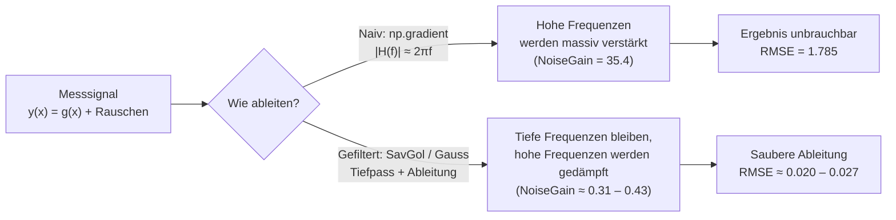
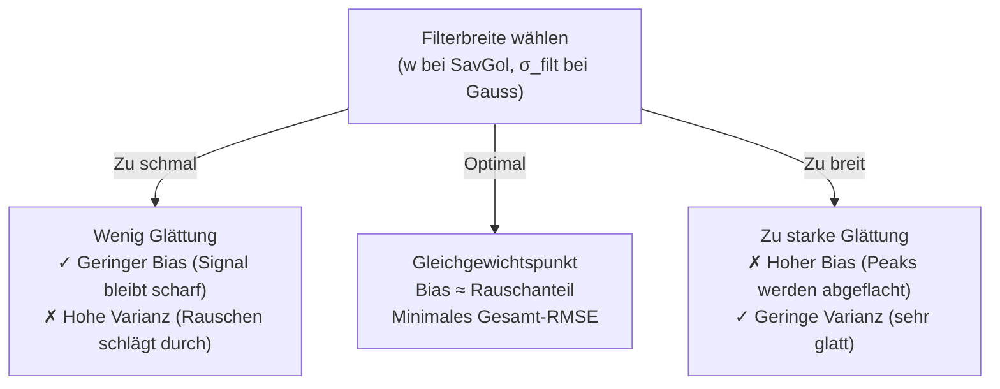
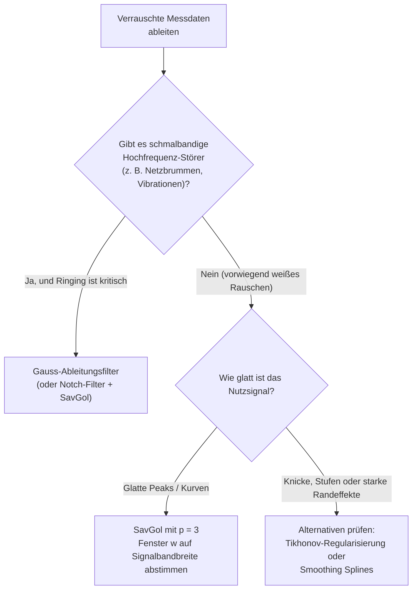

# Verrauschte Signale sauber ableiten: Savitzky-Golay vs. Gauß-Ableitungsfilter

*Ein didaktischer Bericht über das Rauschverstärkungs-Dilemma bei der numerischen Differentiation, den Bias-Varianz-Tradeoff und warum ein Blick in den Frequenzraum alles erklärt.*

---

## Kurzfassung

Wer reale Messdaten ableiten möchte, steht vor einem klassischen Dilemma: **Differentiation verstärkt hohe Frequenzen** – und damit genau dort, wo das Messrauschen sitzt. Eine naive finite Differenz (`np.gradient`) verstärkt in unserem Experiment das Eingangsrauschen ($\sigma = 0.05$) um das **35.4-Fache** und macht das Nutzsignal völlig unkenntlich ($\text{RMSE} = 1.785$).

In einer Monte-Carlo-Simulation ($n = 40$ Rausch-Realisierungen) auf einem verrauschten Gauß-Signal untersuchen wir zwei glättende Alternativen – den **Savitzky-Golay-Filter (`SavGol`)** und den **Gauß-Ableitungsfilter (`Gauss-Deriv`)**:

* **Bei weißem Rauschen** gewinnt **`SavGol (w=125, p=3)`** deutlich ($\text{RMSE} = 0.02023$ vs. $0.02671$, ca. **24 % besser**). Er reduziert sowohl den systematischen Fehler (Bias) als auch das Rauschen stärker als der Gauß-Filter.
* **Bei einem schmalbandigen 2.0-Hz-Störer** dreht sich das Blatt: **`Gauss-Deriv`** schlägt `SavGol` um rund **25 %** ($\text{RMSE} = 0.01967$ vs. $0.02610$), weil SavGol im Sperrbereich Nebenkeulen besitzt, während der Gauß-Filter dort praktisch komplett auf null abfällt.

---

## 1. Einleitung: Warum Ableiten von Messdaten so tückisch ist

Stell dir vor, du misst die Position eines Objekts alle $\Delta x = 0.02\,\text{s}$ und möchtest daraus die Geschwindigkeit (die 1. Ableitung) berechnen. Dein Sensor ist eigentlich sehr genau: Das Rauschen beträgt nur $\sigma_{\text{noise}} = 0.05$ gegenüber einer Signalhöhe von $1.0$ – ein entspanntes Signal-zu-Rausch-Verhältnis von $20:1$.

Du wendest die naheliegendste Formel aus dem Lehrbuch an – die **zentrale finite Differenz** (`np.gradient`):

$$\hat{y}'_i = \frac{y_{i+1} - y_{i-1}}{2\,\Delta x}$$

Was passiert? Zwei benachbarte Messpunkte enthalten zwei unabhängige Zufallsfehler $\varepsilon_{i+1}$ und $\varepsilon_{i-1}$. Ihre Differenz hat eine Standardabweichung von $\sqrt{2}\,\sigma_{\text{noise}}$. Anschließend teilst du durch $2\,\Delta x = 0.04$:

$$\sigma_{\text{out}} = \frac{\sqrt{2}\,\sigma_{\text{noise}}}{2\,\Delta x} = \underbrace{\frac{1}{\sqrt{2}\,\Delta x}}_{\text{NoiseGain} \approx 35.4} \cdot \sigma_{\text{noise}} \approx 1.77$$

Das Ergebnis ist dramatisch: Die wahre maximale Steigung unseres Gauß-Signals beträgt gerade einmal $|g'(\pm 1)| = e^{-0.5} \approx 0.61$. Die naive Ableitung erzeugt jedoch Zacken bis $\pm 5.5$ – **fast neunmal größer als das eigentliche Nutzsignal**.

### Die Erklärung im Frequenzraum

Im Frequenzraum entspricht die ideale Ableitung einer Multiplikation mit $i\,2\pi f$: Ihr Amplitudengang wächst linear mit der Frequenz ($|H_{\text{ideal}}(f)| = 2\pi f$). Ein glattes Nutzsignal besitzt seine Energie bei tiefen Frequenzen, während weißes Rauschen über das gesamte Spektrum bis zur Nyquist-Frequenz ($f_{\text{Nyq}} = \frac{1}{2\Delta x} = 25\,\text{Hz}$) verteilt ist. Ein ungefilterter Differentiator wirkt daher wie ein **Rauschverstärker**.

Die Lösung lautet also: **Glätten und Ableiten kombinieren** – genau das tun der Savitzky-Golay-Filter und der Gauß-Ableitungsfilter, allerdings auf grundlegend verschiedene Weise.

---

## 2. Die Kontrahenten und der Bias-Varianz-Tradeoff

### Savitzky-Golay-Filter (`SavGol`)
Anstatt Punkte einfach zu mitteln, legt `SavGol` in einem wandernden Fenster der Breite $w$ (ungerade Punktzahl) ein **Polynom vom Grad $p$** per Methode der kleinsten Quadrate durch die verrauschten Daten und wertet die Ableitung dieses Polynoms im Fenstermittelpunkt aus.

* **Intuition:** Da ein kubisches Polynom ($p=3$) Krümmungen und Wendepunkte exakt nachbilden kann, bleibt ein echtes Signal auch über relativ breite Fenster unverzerrt.
* **Eigenheit:** Auf äquidistanten Gittern liefern bei der 1. Ableitung aufeinanderfolgende gerade und ungerade Ordnungen (z. B. $p=1$ und $p=2$, oder $p=3$ und $p=4$) exakt dieselben Filterkoeffizienten.

### Gauß-Ableitungsfilter (`Gauss-Deriv`)
Hier nutzt man eine mathematische Eleganz der Faltung: Die Ableitung eines mit einer Gauß-Glocke $G_\sigma$ geglätteten Signals ist identisch mit der Faltung des Originalsignals mit der abgeleiteten Gauß-Glocke:

$$(g * G_\sigma)' = g * G'_\sigma$$

* **Intuition:** Ein einzelner Parameter $\sigma_{\text{filt}}$ steuert die Glättungsbreite. Die Filtergewichte klingen glockenförmig und glatt auf null ab – ohne harte Fensterkanten.

### Das zentrale Spannungsfeld: Bias vs. Varianz

Beide Verfahren müssen zwischen zwei gegensätzlichen Fehlern abwägen:

---

## 3. Versuchsaufbau

Das Python-Testprogramm wurde deklarativ über ein kompaktes Common-Lisp-Skript (`cl-py-generator`) erzeugt und mittels `uv` ausgeführt.

| Parameter | Wert | Bedeutung |
| :--- | :--- | :--- |
| **Testsignal** | $g(x) = \exp\!\left(-\frac{x^2}{2\sigma^2}\right)$, $\sigma = 1.0$ | Glatter Gauß-Puls auf $x \in [-5, 5]$ mit $501$ Punkten ($\Delta x = 0.02$) |
| **Exakte Referenz** | $g'(x) = -\frac{x}{\sigma^2}\,g(x)$ | Analytische Ableitung, Peak bei $\pm 0.6065$ |
| **Weißes Rauschen** | $\sigma_{\text{noise}} = 0.05$, $n_{\text{MC}} = 40$ | 40 unabhängige Monte-Carlo-Realisierungen (Mittelwert $\pm 1\sigma$) |
| **SavGol-Sweep** | $p \in \{1, 3, 5\}$, $w \in [5, 251]$ | Suche nach dem globalen Bias-Varianz-Minimum |
| **Gauss-Sweep** | $\sigma_{\text{filt}} \in [0.05, 1.50]$ | 60 Stützstellen für das optimale Gauß-Filter |
| **Stresstest** | $g(x) + 0.05 \sin(2\pi \cdot 2.0\,x)$ | Schmalbandige Störfrequenz bei $2.0\,\text{Hz}$ (Sperrband-Test) |

---

## 4. Ergebnisse und Diskussion

Die gesamte Auswertung ist in den vier Teilgrafiken von `savgol_analyse.png` sowie in den berechneten Kennzahlen zusammengefasst:

### 4.1 Kennzahlen im Vergleich

| Methode | Parameter | MC-RMSE ($n=40$) | Bias-Anteil | Rausch-Anteil | NoiseGain | 2.0-Hz-Störtest RMSE |
| :--- | :--- | :---: | :---: | :---: | :---: | :---: |
| **`np.gradient`** | zentral, $\Delta x = 0.02$ | `1.78516` | $\approx 0$ | `1.768` | `35.355` | – |
| **`Gauss-Deriv`** | $\sigma_{\text{filt}} = 0.247$ | `0.02671` | `0.01559` | `0.02169` | `0.434` | **`0.01967`** |
| **`SavGol` (Opt.)** | $w = 125,\; p = 3$ | **`0.02023`** | **`0.01300`** | **`0.01550`** | **`0.310`** | `0.02610` |

Zusätzliche Momenten-Prüfung für den optimalen `SavGol`-Filter:
* **DC-Unterdrückung** ($\sum h_k$): `1.67e-15` (ein konstanter Offset wird exakt auf null abgebildet).
* **Rampen-Normierung** ($\sum -k\,\Delta x\,h_k$): `1.000000` (eine lineare Rampe $y = x$ liefert exakt die Steigung $1$).
* **$-3\,\text{dB}$-Grenzfrequenz** relativ zu $2\pi f$: `0.50 Hz`.

---

### 4.2 Zeitbereich: Rauschunterdrückung auf einen Blick *(oben links & rechts)*

* **Oben links:** Das verrauschte Eingangssignal (hellblau) folgt dem sauberen Gauß-Puls mit deutlich sichtbarem Jitter ($\sigma = 0.05$).
* **Oben rechts:** Der Unterschied in der 1. Ableitung ist drastisch. Die graue Kurve (`np.gradient`) geht komplett im Rauschen unter. Sowohl `SavGol (w=125, p=3)` als auch `Gauss-Deriv (s=0.25)` schmiegen sich dagegen eng an die schwarze exakte Kurve $g'(x)$ an. Auf der Zeitachse scheinen beide Filter fast gleich gut – die entscheidenden Unterschiede zeigen sich erst in den unteren beiden Plots.

---

### 4.3 Die Bias-Varianz-Landschaft *(unten links)*

Durch die logarithmische Y-Achse und den weiten Suchbereich bis $w = 251$ (entspricht $5.0$ $x$-Einheiten) zeigen alle drei Polynomgrade lehrbuchmäßige **U-Kurven** mit engen `±1σ`-Fehlerbändern:

1. **Links der Minima (Varianz-dominiert):** Bei zu kleinen Fenstern dominiert das Rauschen. Dabei liegt ein höherer Polynomgrad (`p=5` > `p=3` > `p=1`) systematisch höher, weil mehr freie Polynom-Parameter auch mehr Rauschvarianz einfangen.
2. **Rechts der Minima (Bias-dominiert):** Bei zu breiten Fenstern krümmt sich der Gauß-Puls stärker, als es ein niedriges Polynom abbilden kann – der systematische Fehler steigt.
3. **Warum `poly=1` genau auf der Gauß-Linie landet:** Das Minimum von `poly=1` ($w \approx 55$) berührt exakt die gestrichelte **`Gauss Opt. (0.0267)`**-Linie. Das ist kein Zufall: Sowohl `SavGol (p=1)` als auch der Gauß-Filter haben eine Fehlerordnung von $\mathcal{O}(h^2)$ – keiner hat beim Bias einen asymptotischen Vorteil.
4. **Warum `poly=3` gewinnt:** Weil ein kubisches Polynom die Krümmung um die Wendepunkte des Gauß-Signals deutlich länger präzise nachbilden kann, darf das Fenster auf **$w = 125$** anwachsen, bevor der Bias überhandnimmt. Bei $w = 125$ sind Bias (`0.01300`) und Rauschen (`0.01550`) nahezu perfekt ausbalanciert – genau die Signatur eines echten Bias-Varianz-Optimums.
5. **Warum `poly=5` wieder leicht zurückfällt:** Das 5.-Grad-Polynom verschiebt das Optimum zwar noch weiter nach rechts ($w \approx 195$), fängt bei gleicher effektiver Bandbreite aber wieder etwas mehr Rauschen ein als `poly=3`.

---

### 4.4 Der Blick in den Frequenzraum: Der Plot-Twist bei 2.0 Hz *(unten rechts)*

Das Spektraldiagramm unten rechts erklärt **gleichzeitig**, warum `SavGol` beim weißen Rauschen dominiert, beim schmalbandigen Störer aber verliert:

* **Der Durchlassbereich ($0$ bis $0.5\,\text{Hz}$):**
  Die grau schattierte Fläche zeigt das normierte Ableitungsspektrum $|g'(f)|$ unseres Signals – fast **100 % der Signalenergie liegen unterhalb von $0.5\,\text{Hz}$**.
  * **SavGol (orange)** schmiegt sich bis ca. $0.35\,\text{Hz}$ eng an die ideale Gerade $2\pi f$ an (geringer Bias: `0.01300`) und knickt dann bei $f_{-3\text{dB}} = 0.50\,\text{Hz}$ steil nach unten ab.
  * **Gauss (grün gestrichelt)** fällt dagegen schon im Nutzsignalband ab $0.15\,\text{Hz}$ früher ab (mehr Bias: `0.01559`), bleibt aber anschließend zwischen **$0.55\,\text{Hz}$ und $1.6\,\text{Hz}$** deutlich höher als `SavGol` (grüne Kurve über der orangenen!). In diesem Frequenzbereich liegt kein Nutzsignal mehr, sondern nur noch weißes Rauschen – der Gauß-Filter lässt also unnötig viel Rauschen passieren (`Noise: 0.02169` vs. `0.01550`).

* **Das Sperrband ($1.0$ bis $3.0\,\text{Hz}$):**
  Ab $1.7\,\text{Hz}$ kehren sich die Verhältnisse um. Weil ein `SavGol`-Filter im Zeitbereich ein **hart abgeschnittenes Fenster** nutzt (rechteckige Trunkierung eines Polynomfits), entstehen im Frequenzraum typische **Nebenkeulen (Sidelobes)** mit einer Amplitude von immerhin $\sim 0.3\text{–}0.8$. Der Gauß-Filter klingt hingegen **monoton und ohne jedes Überschwingen** exponentiell gegen null ab.

* **Die Bestätigung im 2.0-Hz-Stresstest:**
  Addiert man statt weißem Rauschen eine periodische Störung bei $f = 2.0\,\text{Hz}$ (exakt im Bereich der dritten `SavGol`-Nebenkeule), schlägt **`Gauss-Deriv` (`RMSE = 0.01967`)** den **`SavGol`-Filter (`RMSE = 0.02610`)** deutlich!

---

## 5. Praxisleitfaden & Nächste Schritte

### Entscheidungsbaum für eigene Daten

### Empfohlene nächste Schritte

1. **Randverhalten testen (`mode='interp'` vs. `'reflect'`):**
   In diesem Experiment lief das Signal an den Rändern $x = \pm 5$ auf null aus. Bei Messkurven, die am Rand nicht abflachen (z. B. steigende Rampen oder abgeschnittene Transienten), bestimmt die Randbehandlung maßgeblich den Fehler. Ein gezielter Vergleich von `savgol_filter(..., mode="interp")` gegen `gaussian_filter1d(..., mode="nearest" / "reflect")` lohnt sich hier sofort.
2. **SNR-Skalierungsstudie ($\sigma_{\text{noise}} \in [0.005, 0.25]$):**
   Ein Sweep über verschiedene Rauschstärken zeigt, ab welchem Rauschpegel die optimale Fensterbreite $w_{\text{opt}}$ so groß wird, dass `poly=5` oder ein adaptiver Ansatz gegenüber `poly=3` Vorteile gewinnt.
3. **Erweiterung auf die 2. Ableitung (`deriv=2`, z. B. für Peak-Erkennung / Krümmung):**
   Bei der 2. Ableitung skaliert das Rauschen quadratisch mit der Frequenz ($|H_{\text{ideal}}(f)| = (2\pi f)^2$). Hier verschieben sich die optimalen Fensterlängen noch weiter nach oben und der Vergleich mit **Smoothing Splines** oder **Total-Variation-/Tikhonov-Regularisierung** wird besonders spannend.
4. **Anwendung auf reale Messdaten ohne Ground Truth:**
   Da in der Praxis die exakte Ableitung $g'(x)$ unbekannt ist, lässt sich das optimale $w$ statt über den Oracle-RMSE mittels **Cross-Validation (Leave-One-Out / Generalized Cross-Validation)** oder über die **L-Kurve** (Residuum vs. Glattheit der Ableitung) automatisch bestimmen.
