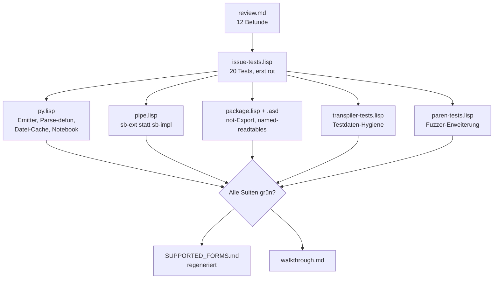
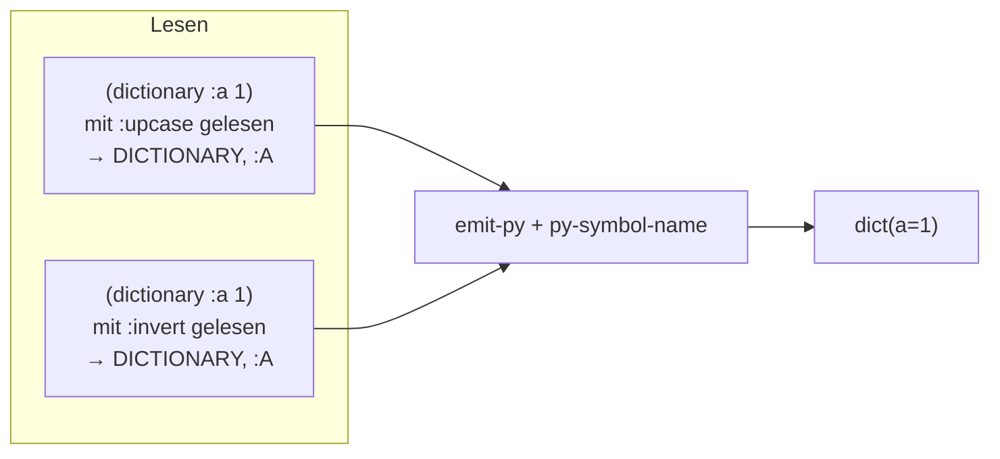
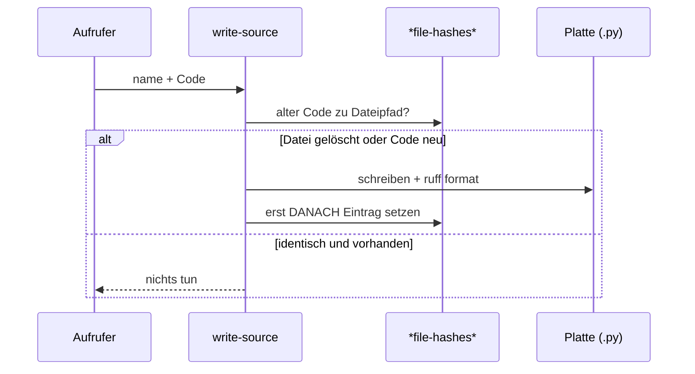
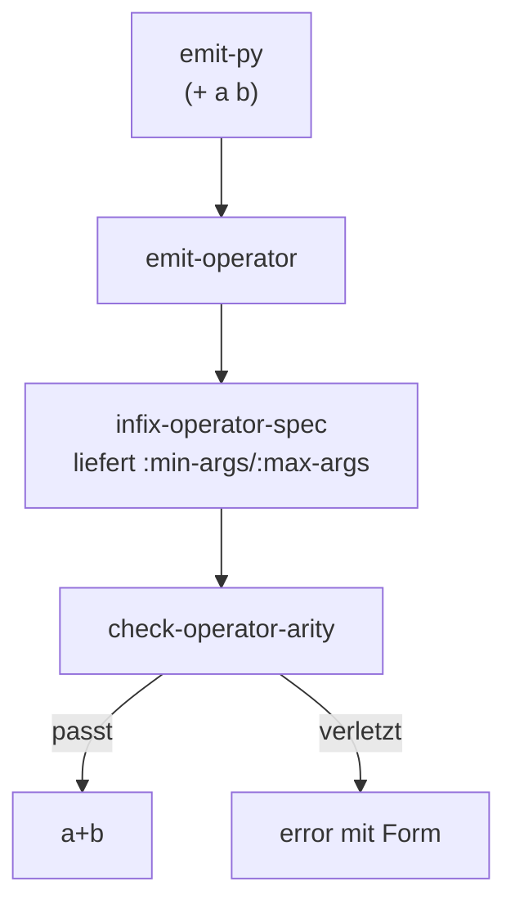

# Walkthrough: Hydrogen-Review umsetzen

Branch: `feature/hydrogen-review` (Basis: `master`).
Dieser Text erklärt Schritt für Schritt, was gebaut wurde, welche
Entscheidung Tests erzwungen haben, was wir gelernt haben und was noch offen
ist. Alle Fachbegriffe werden bei erster Verwendung erklärt.

## Nachtrag: Abnahme-Check (PR-Review, 13.11.)

Ein Gegen-Check fand vier kleine Restpunkte, die danach behoben wurden (alle
Suiten weiterhin grün: 22 Issue-Tests, 160 Transpiler-Tests, Paren-Fuzzer
0 Fehler):

1. `write-notebook` prüfte den Zelltyp noch per `eq 'markdown` — aus fremden
   Paketen scheiterte das. Jetzt entscheidet der (großgeschriebene) Name, wie
   schon in `notebook-cell-source`.
2. `py-symbol-name` kleinschrieb entgegen seinem Docstring auch rohe Strings
   (`"API"` → `"api"`). Jetzt werden nur Symbole normalisiert, alles andere
   läuft unverändert durch.
3. `dot` auf positiven Zahlen (`3.bit_length()`) ist in Python ein
   Syntaxfehler; der Fuzzer merkte es nicht, weil beide Modi denselben Fehler
   warfen. `emit-operand` klammert Zahlen als `dot`-Objekt jetzt (`(3).bit_length()`).
4. `lambda` ignorierte `&optional`/`&rest` stillschweigend — jetzt wie
   `parse-defun` als `b = None` bzw. `*c` unterstützt; der Skill-Text erwähnt
   zusätzlich `|Name|`-Escaping als Alternative zu `named-readtables`.

## Glossar

- **Readtable**: Die Tabelle in Common Lisp (CL), die festlegt, wie Zeichen beim
  Einlesen (Lesen) von Code in Symbole verwandelt werden. `readtable-case`
  steuert dabei die Groß-/Kleinschreibung: `:upcase` (Standard) macht aus
  `foo` das Symbol `FOO`, `:invert` dreht die Schreibung einsilbiger Token um.
- **Emitter**: Die Funktion `emit-py`, die aus einer S-Expression (einer
  Lisp-Liste wie `(setf x 1)`) eine Python-Zeichenkette (`x=1`) erzeugt.
- **DSL** (Domain-Specific Language, domänenspezifische Sprache): Die
  S-Expression-Formen (`def`, `dot`, `aref`, …), die der Emitter versteht.
- **Orakel-Modus**: Der voll geklammerte Ausgabemodus
  (`:omit-redundant-parentheses nil`). Er hängt von keiner
  Operator-Präzedenz ab und dient den Differentialtests als Referenz: Beide
  Modi müssen in Python denselben Wert ergeben.
- **`sxhash`**: Eine eingebaute, schnelle Hash-Funktion. Sie ist nicht
  kryptografisch — Kollisionen sind möglich — und taugt daher schlecht als
  Datei-Vergleich.
- **SBCL** (Steel Bank Common Lisp): Der verwendete Lisp-Compiler.
- **`named-readtables`**: Eine kleine Bibliothek, mit der eine Datei ihre
  eigene Readtable wählen kann (`in-readtable`), ohne die globale Readtable
  aller anderen Dateien zu verändern.
- **Fuzzer**: Ein Test, der zufällige Eingaben erzeugt (hier: zufällige
  Ausdrücke mit festem Startwert, engl. Seed, damit Läufe wiederholbar sind).

Zu Bildern: In diesem Durchgang sind keine Rastergrafiken entstanden; alle
Abbildungen sind Mermaid-Diagramme, die der Markdown-Betrachter darstellt.

## 1. Was exakt implementiert wurde

Ausgangspunkt waren zwei Dokumente: das strukturierte Code-Review
(`review.md`, 12 Befundgruppen) und die daraus abgeleitete Test-Suite
(`issue-tests.md`, 20 Tests). Vorgehen: Tests zuerst bauen, auf unkorrigiertem
Code rot sehen (19 von 20 scheiterten, nur die `comments`-Regression war
grün), dann Befund für Befund beheben, bis alle 20 grün sind. Danach liefen
die bestehenden Suiten (`run-tests.sh`: 160/160,
`run-paren-tests.sh`: 0 Fehler bei 2000 zufälligen Ausdrücken) und die Doku
(`SUPPORTED_FORMS.md`) wurde neu erzeugt.

### 1.1 Übersicht der Änderungen



### 1.2 Die einzelnen Korrekturen mit Beispielen

**Readtable-Entgiftung (Befund 2.1).** Die Zeile
`(setf (readtable-case *readtable*) :invert)` in `py.lisp` veränderte beim
Laden der Bibliothek die globale Readtable der gesamten Lisp-Sitzung. Sie ist
ersatzlos gestrichen. Damit alle Dateien — egal mit welcher Readtable gelesen —
kleines Python erzeugen, gibt es die neue Hilfsfunktion `py-symbol-name`:
Namen ohne Kleinbuchstaben werden kleingeschrieben (`FOO` → `foo`,
Schlüsselwort `:A` → `a`), Namen mit Kleinbuchstaben bleiben unverändert
(`|MyVar|` bleibt `MyVar`). Sie wird an jeder Stelle verwendet, die ein Symbol
als Python-Bezeichner druckt (Variablen, Funktions-, Klassen- und `def`-Namen,
Schlüsselwort-Argumente, `import`-Namen, `else`/`finally` in `try`).



Beispiel aus der Test-Suite (Test `readtable-upcase-keywords`):
Eingabe `(dictionary :a 1)`, gelesen mit Standard-`:upcase`-Readtable, ergibt
`dict(a=1)` — vorher kam `dict(A=1)` heraus.

Die Testdateien (`transpiler-tests.lisp`, `paren-tests.lisp`) lesen ihre
*Testfälle* weiterhin mit `:invert`, aber jetzt dateilokal über
`(named-readtables:in-readtable :cl-py-generator)` statt über globalen
Seiteneffekt. So bleiben gemischte Namen wie `Foo` oder `Exception` erhalten,
während die Bibliothek selbst niemanden mehr beeinflusst. `package.lisp`
definiert dafür nur die benannte Readtable; `cl-py-generator.asd` deklariert
`named-readtables` als Abhängigkeit.

**`cl-ppcre`-Abhängigkeit entfernt (Befund 2.2).** `comments` ersetzte
Zeilenumbrüche per Regex-Engine; jetzt tut das die kleine Schleife
`comment-newlines` mit Bordmitteln. Auch `normalize-string` in den Tests kommt
ohne `cl-ppcre` aus. Die `.asd`-Datei bleibt schlank. Beispiel
(Test `comments-multiline-string`):

- Eingabe: `(comments "line1<newline>line2")`
- Ausgabe:
  ```python
  # line1
  # line2
  ```

**`paren*`-Fallback repariert (Befund 2.3).** Im Orakel-Modus wurde bei drei
Argumenten das Positions-Schlüsselwort mit ausgegeben:
`(paren* * (+ a b) :left)` → `(((a)+(b)), left)`. Jetzt prüft die Funktion
Argumentzahl und Position *vor* der Modus-Verzweigung und klammert im
Legacy-Zweig exakt `(third code)`:

- Orakel-Modus: `(((a)+(b)))`
- Ungültige Position (`:bogus`) wirft in beiden Modi einen Fehler.

**`:str`-Parameter entfernt (Befund 2.4).** `emit-py` nahm `:str` an, schrieb
aber nur bei reinen Zahlen dorthin — zusammengesetzte Formen ignorierten den
Stream stillschweigend. Da kein Aufrufer in `example/` ihn nutzt, ist der
Parameter gestrichen; `emit-py` liefert immer eine Zeichenkette. (Der
Issue-Test akzeptiert alternativ auch eine funktionierende `:str`-Variante;
die Entfernung entspricht der vom Review bevorzugten Lösung.)

**Testdaten korrigiert (Befund 2.5).** `with-basic`/`with-as-basic` enthielten
`(open \"f.txt\")` — außerhalb einer Zeichenkette liest Lisp das als *Symbol*
mit Anführungszeichen im Namen (`|"F.TXT"|`, sichtbar auch in der alten Doku).
Jetzt steht dort `(open (string "f.txt"))` wie schon bei `with-multiple`.
Zusätzlich wurde `E` in `def-type-annotations` zu `e` (siehe Kapitel 2, warum
das unvermeidlich ist).

**`parse-defun` gehärtet (Befund 2.6).** Vier Lücken sind geschlossen:

| Eingabe | Vorher | Nachher |
|---|---|---|
| `(values (aref list int))` als Rückgabetyp | `->(aref list int)` (rohe Lisp-Syntax) | `-> list[int]` (durch `emit` geschickt) |
| `&key (y)` ohne Default | `y = ` (ungültiges Python) | `y = None` |
| `(def foo ())` ohne Rumpf | `def foo():` + nichts (Syntaxfehler) | `def foo():` + `pass` |
| `&optional b &rest c` | stillschweigend verworfen | `b = None`, `*c` in der Signatur |

Die ungenutzte `captures`-Sammlung in `consume-declare` ist entfernt.

**`return` direkt implementiert (Befund 2.7).** `(return x y)` verwarf `y`
lautlos; `(return nil)` ergab `"return "` (mit Leerzeichen). Jetzt gilt:
0 Argumente → `"return"`, 1 Argument → `"return <Ausdruck>"` (dabei `nil` →
`None`), mehr Argumente → Fehler mit Hinweis auf `(return (ntuple ...))`.
`return_` bleibt als Wrapper für Bestandstests erhalten.

**`write-source`-Cache repariert (Befund 3.1).** Die alte Tabelle nutzte
`sxhash`-Werte als Schlüssel *und* Wert (kollisionsanfällig), übersprang das
Schreiben gelöschter Dateien (Cache-Treffer ohne `probe-file`) und merkte sich
den Hash *vor* dem Schreiben (Inkonsistenz bei I/O-Fehlern). Jetzt: normale
`equal`-Tabelle mit Dateipfad als Schlüssel und Code als Wert, Schreiben nur
bei unterschiedlichem Inhalt *und* vorhandener Datei überspringen, Eintrag erst
nach erfolgreichem Schreiben setzen.



**`write-notebook` entkoppelt (Befund 3.2).** Jede Python-Expression lief
früher über `write-source` in eine *feste* Temp-Datei
(`cl-py-generator-cell.py`) — inklusive eigenem `ruff`-Prozess pro Expression,
Müll im Temp-Verzeichnis und Wechselwirkung mit dem Datei-Cache. Jetzt
emittiert `notebook-cell-source` die Zelle im Speicher und formatiert sie
genau einmal über `uiop:with-temporary-file`. Keine feste Datei bleibt zurück,
ein zweiter Aufruf funktioniert auch nach Löschen aller Temp-Dateien. Als
Nebeneffekt wurde die Zelltyp-Erkennung paket-agnostisch: `python`/`markdown`
werden per Name (großgeschrieben normiert) verglichen, sodass Aufrufe aus
beliebigen Paketen funktionieren — vorher scheiterte `write-notebook` aus
fremden Paketen mit „unsupported notebook cell type“.

**SBCL-Interna ersetzt (Befund 3.3, `pipe.lisp`).**
`sb-impl::process-%status`/`sb-impl::process-pty` (undokumentierte Interna)
wurden durch die dokumentierte API `sb-ext:process-status`/`sb-ext:process-pty`
ersetzt; `read-line` nutzt `nil` statt `'foo` als EOF-Marker.

**Arität geprüft (Befund 3.4).** Operatoren ohne sinnvolle leere Anwendung
melden jetzt Fehler: `+ - * and or & logand ^ logxor | logior` verlangen
mindestens 1 Argument, `< > <= >= == != << >> @` mindestens 2 (`/` `//` `%`
`**` `in`/`is`/`not`/`~` hatten bereits Grenzen). `(+)`, `(-)`, `(== a)`,
`(<< a)` werfen Fehler; `(+ x)` und `(or 255)` bleiben für Makros legal.
Der Datenfluss der Prüfung:



**Paket und Testläufer (Befunde 4.x).** `:not` ist in `package.lisp`
exportiert (wie `and`/`or`). Fragment-Testfälle, die für sich kein gültiges
Python sind (`for-generator-basic`, `space-basic`), tragen `:skip-ruff t`;
Läufer und Doku-Generator vergleichen sie roh statt Ruff-Warnungen zu
produzieren. Der Fuzzer in `paren-tests.lisp` prüft zusätzlich `in`/`not-in`,
`/`, `aref` auf Listen, `dot` (`bit_length`), `lambda`-Aufrufe und
zweiarmiges `?`.

## 2. Architektur-Entscheidungen, die Tests spontan geändert haben

Drei Stellen zwangen die Testläufe zu einer anderen Lösung als zuerst gedacht.

### 2.1 Vom Drucker-Trick zur expliziten Kleinschreibung

Ursprünglich sah der Plan vor, die globale `:invert`-Readtable einfach zu
streichen und Symbole pauschal kleinzuschreiben. Der erste grüne Lauf zeigte
dann: `try-basic` brach — `else`/`finally` wurden als `ELSE:`/`FINALLY:`
gedruckt, weil sie per `format` direkt (nicht über `emit`) ausgegeben wurden.
Die Lehre: **Jede Stelle, die ein Symbol als Python-Bezeichner druckt, muss
durch `py-symbol-name` laufen.** Der Review hatte nur `dictionary` und
Aufruf-Keywords genannt; `try`/`class`/`import`/Funktionsaufrufe kamen durch
Test-Feedback hinzu.

Dahinter steckt ein subtiler Mechanismus, den die Analyse erst spät freilegte:
SBCLs Drucker kompensiert die Readtable. Mit `:invert`-Readtable druckt `~a`
das intern großgeschriebene Symbol `DATA` als `data` — damit Einlesen und
Drucken zueinander invers bleiben. Die alte Suite war also nicht deshalb grün,
weil Symbole klein *waren*, sondern weil der Drucker sie klein *machte*.
`py-symbol-name` macht genau diese Kompensation explizit und
readtable-unabhängig.

### 2.2 Vom Orakel mit Loch zum klammernden Orakel

Die Fuzzer-Erweiterung (`dot` mit `bit_length`) produzierte sofort 10
Mismatches — aber nicht wegen des neuen Emit-Codes, sondern wegen einer Lücke
im *Orakel-Modus*: `(dot -3 c)` wurde dort zu `-3.bit_length()` (ungültiges
Python), während der neue Modus korrekt `(-3).bit_length()` erzeugte. Ursache:
Im Legacy-Zweig wurden `dot`-Objekt und `aref`-Sequenz per rohem `emit`
ausgegeben, und ganze Zahlen tragen im Legacy-Modus keine Klammern. Die
Reparatur nutzt `emit-operand` für Objekt/Sequenz in *beiden* Modi — der
Orakel-Modus bleibt vollständig geklammert, ist aber jetzt auch korrekt. Das
ist ein schöner Beleg für den Wert des Differentialtests: Der Fuzzer fand einen
Fehler, den kein handgeschriebener Test abdeckte.

### 2.3 Vom Großbuchstaben, den keine Readtable rettet

Der Test `def-type-annotations` nutzte den Parameter `E`. Unter `:invert` liest
sich `E` als `e` — die Information „war groß“ ist beim Einlesen unwiderruflich
verloren, kein Emitter der Welt kann daraus wieder `E` machen. (Unter
`:upcase` landet `E` zwar als `E` im Symbol, wird dann aber per Konvention zu
`e`.) Der Testfall nutzt daher jetzt `e`. Gemischte Namen (`Foo`,
`Exception`, `Path`) sind nicht betroffen: Sie überleben `:invert` und werden
1:1 übernommen. Merksatz: **Rein großgeschriebene Bezeichner sind in dieser
DSL nicht darstellbar** — dokumentiert auch im aktualisierten Skill-Text
(`.agents/skills/cl-py-generator/SKILL.md`).

### 2.4 Warum `in-readtable` nur halb reicht

Ein Zwischenschritt sah vor, die Testdateien per `named-readtables`
einzuklinken. Das funktioniert — aber nur *während des Ladens*: SBCL bindet
`*readtable*` beim Laden, sodass die Dateioption danach zurückfällt. Für das
*Lesen* der Testfälle reicht das völlig (sie werden beim Laden gelesen). Für
das *Drucken* in `generate-documentation` (läuft nach dem Laden per `--eval`)
musste die Tabelle deshalb explizit gebunden werden — sonst zeigte die Doku
plötzlich `(TRY (SETF A 1) ...)` statt `(try (setf a 1) ...)`. Die finale Doku
unterscheidet sich von Master nur an den drei beabsichtigten Stellen
(`with-basic`, `with-as-basic`, `e`-Parameter).

## 3. Learnings und mögliche Erweiterungen

**Learnings.**

- *Annahmen über Einlesen/Drucken explizit testen.* Der SBCL-Drucker, der
  `:invert` kompensiert, war die unsichtbare Grundlage der alten Suite. Erst
  ein Test, der beide Welten (`readtable-not-mutated` *und*
  `readtable-upcase-keywords`) festnagelt, machte die implizite Annahme
  sichtbar.
- *Der Orakel-Modus ist Code wie jeder andere.* Er hatte denselben
  Klammer-Bug wie Produktivcode — nur fiel es nie auf, weil nichts
  `dot`-Objekte mit negativen Zahlen dagegenhielt. Orakel brauchen eigene
  Regressionstests (jetzt via Fuzzer abgedeckt).
- *Klammer-Edits immer gegen Master diffen.* Zwei überzählige Klammern in neu
  geschriebenem Code legten den Lader lahm; der Vergleich des Hunks mit Master
  zeigt sofort, ob nur Gewolltes drinsteht. Regel für die Zukunft: Nach jeder
  Klammeränderung neu laden *und* den Hunk gegen Master lesen.
- *Vergleichsoperatoren ketten in Python.* `a == b < c` bedeutet
  `(a == b) and (b < c)` — deshalb behält ein Vergleich als Operand eines
  Vergleichs immer seine Klammern (schon vorher so, durch Tests bestätigt).

**Mögliche Erweiterungen (nicht umgesetzt, bewusst zurückgestellt).**

- `&allow-other-keys`/`&aux` in `parse-defun` werden weiterhin ignoriert;
  `&optional`-Einträge mit `supplied-p`-Variable nutzen diese nicht.
- `(string ...)` maskiert keine Anführungszeichen; Raw-Strings als Operanden
  (`(* "1+2" 3)` gruppiert falsch) sind dokumentiert roh — eine eigene
  `pystring`-Form mit Escaping wäre der saubere nächste Schritt.
- Die vielen `#+nil`-Altlasten und `optima`-Kommentare in `py.lisp` sowie die
  `tests.lisp`-Ablage (schreibt beim Laden nach `/dev/shm/o`) warten auf eine
  Aufräum-Passage; `git` bewahrt alles auf.
- Beispiel-Generatoren unter `example/`, die gemischte Namen (`Foo`,
  `Exception` als *Werte*, nicht als Köpfe) nutzen und sich auf globales
  `:invert` verließen, sollten je Datei `(named-readtables:in-readtable
  :cl-py-generator)` erhalten — reine Kleinschreib-Beispiele laufen
  unverändert.
- `pipe.lisp` ließe sich per `uiop:launch-program` portabel machen (heute nur
  SBCL, dafür mit PTY für die interaktive REPL-Nutzung).

## 4. Neue Programme und Pakete für den Docker-Container

Es musste **nichts** nachinstalliert werden — alle Werkzeuge waren im Image
(`Dockerfile` aus `example/05_dockerfile_meta/.../03_ai_env/Dockerfile`)
bereits vorhanden. Fürs Protokoll die verwendeten Versionen:

| Programm | Version | Verwendung |
|---|---|---|
| `sbcl` | SBCL 2.6.0.debian | Laden, Tests (`--disable-debugger`) |
| `ruff` | 0.17.3 | `ruff format` in Läufer, Doku, `write-source` |
| `python3` | 3.14.4 | Ausführungstests + Differential-Orakel |
| `jq` | 1.8.1 | Pretty-Print der Notebooks (`write-notebook`) |
| `uvx` | vorhanden | Fallback-Formatter (nicht benötigt) |

Lisp-seitig kam genau eine neue Laufzeit-Abhängigkeit hinzu, die dauerhaft in
`cl-py-generator.asd` steht:

| System | Zweck |
|---|---|
| `named-readtables` | dateilokale `:invert`-Readtable für Testdateien und Beispiele, ohne globale Mutation |

`cl-ppcre` wird umgekehrt nicht mehr gebraucht (weder in `py.lisp` noch in
`transpiler-tests.lisp` referenziert) — es kann aus Container-Listen für dieses
Projekt gestrichen werden, falls es nur deswegen enthalten war.
